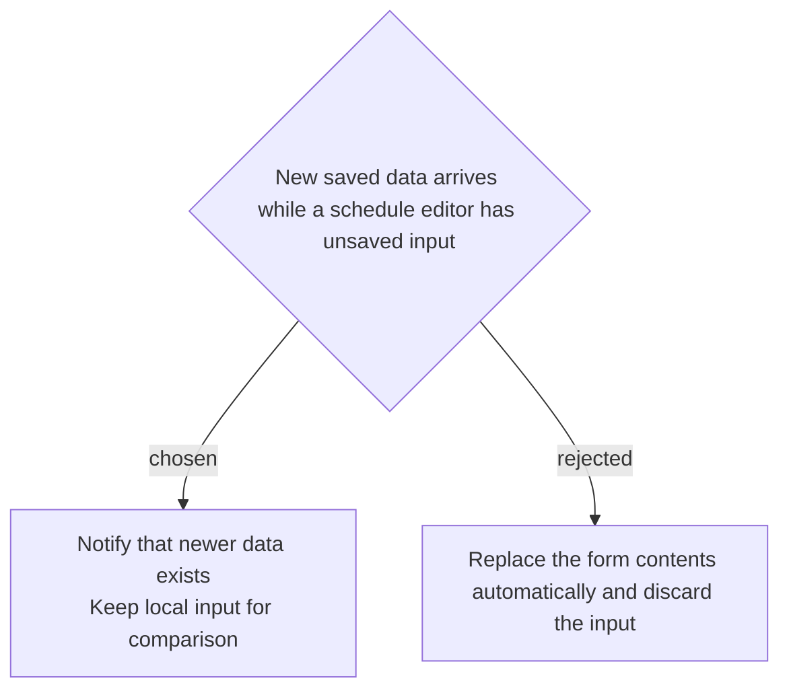

# Schedule refresh notifies editors without erasing unsaved input

On 2026-11-17 the owner accepted the recommended schedule-freshness set: when someone is editing a schedule and newer saved data arrives, notify them without erasing what they are entering. Relevant latest values must be available for comparison; the stale-write protection in [0165](facility-0165-scheduling-rejects-stale-overwrites.md) still prevents an old form from silently overwriting another editor's change.

This extends input preservation to incoming refreshes before a save is attempted. It does not select a merge interface, auto-merge changes, create shared/server drafts, or guarantee input survives closing/reloading the browser. Read-only pages follow [0170](facility-0170-open-schedule-views-refresh-on-change.md). Accepted design only; no application changes.
