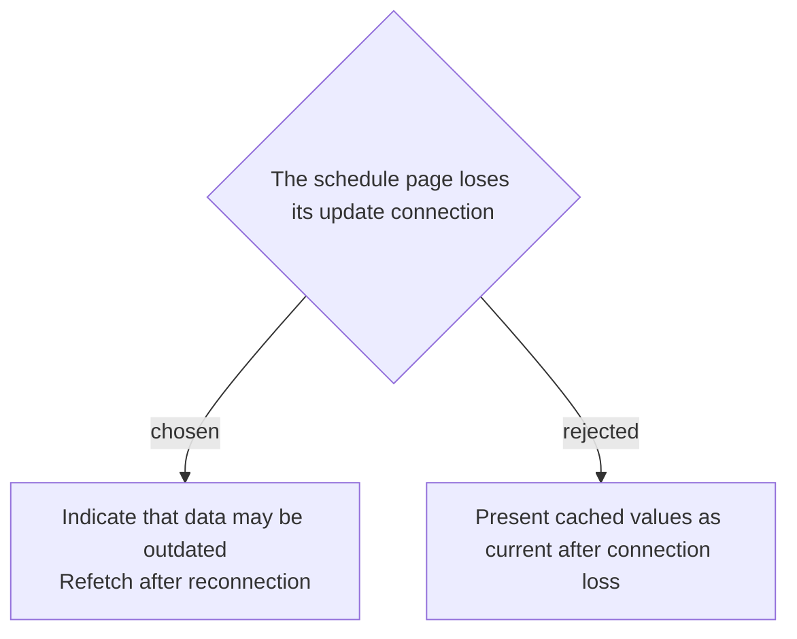

# Schedule views show possible staleness and refetch on reconnect

On 2026-11-17 the owner accepted the recommended schedule-freshness set: when connectivity interrupts schedule updates, clearly indicate that displayed data may no longer be current. Refetch the authorized schedule after reconnection; restored transport alone is not proof that the displayed schedule has caught up. A failed recovery read must not falsely mark stale data as refreshed.

Preserve unsaved form input under [0171](facility-0171-schedule-refresh-preserves-unsaved-input.md) and uncertain save outcomes under [0167](facility-0167-check-uncertain-schedule-save-before-retry.md). This does not introduce offline scheduling or change eligibility based on a cached plan. Detection thresholds, manual retry presentation and recovery transport remain for the spec. Accepted design only; no application changes.
