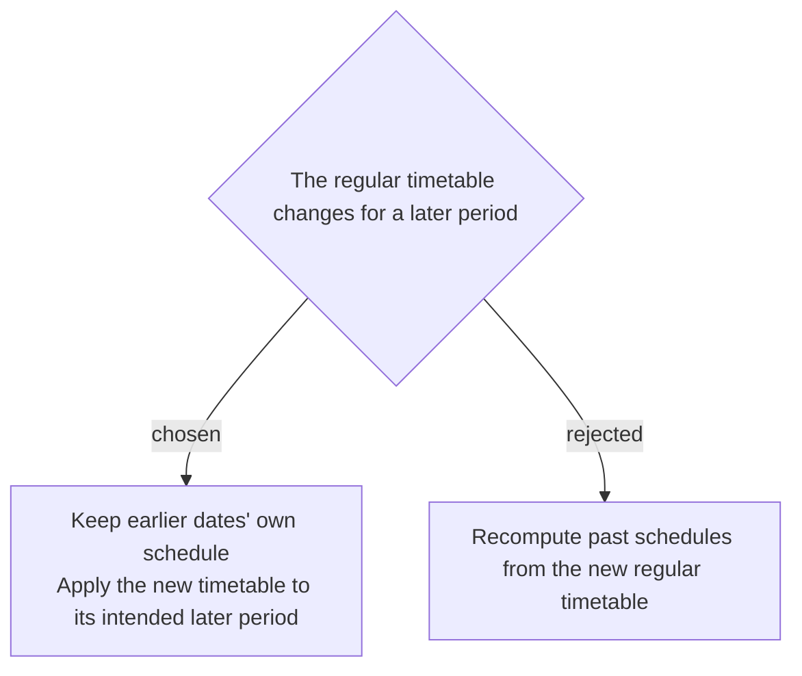

# Later timetable changes preserve earlier dated schedules

On 2026-11-17 the owner accepted the schedule-history set: changing a regular timetable for a later period must not automatically rewrite earlier dated schedules. For example, if a Cleaner works Area A this month and changes to B next month, viewing this month's schedule still shows its own Area A plan.

This concerns automatic propagation from later defaults. It neither authorizes nor prohibits deliberate retrospective corrections, selects an ongoing-shift freeze rule, nor decides the effective-date editing interface. Storage/capture details remain for the spec. It is consistent with the overview's original-target requirement in [0127](facility-0127-overview-history-preserves-original-shift-target.md), without claiming either feature has shipped. Missing history follows [0174](facility-0174-show-unavailable-schedule-history-without-inference.md); actual scans follow [0175](facility-0175-schedule-edits-do-not-rewrite-actual-scan-times.md). Accepted design only; no application changes or extended retention.

**Subsequent clarification:** [0187](facility-0187-regular-timetable-has-a-selected-future-start-date.md) allows the Supervisor to select a future start date for a regular-Cleaner timetable change, including a midweek date. Retrospective corrections, same-day/ongoing-shift rules and future dated-exception conflicts remain unresolved.
