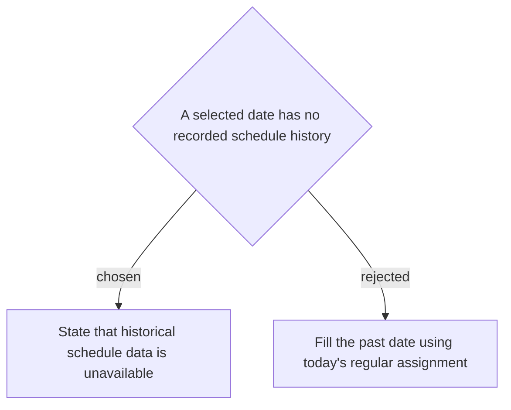

# Show unavailable schedule history without inferring it from current settings

On 2026-11-17 the owner accepted the schedule-history set: dates without recorded schedule history, including dates before history capture starts, must be identified honestly as unavailable. Do not infer those historical schedules from the current regular assignment or present missing history as a verified day off or an unassigned workday.

This applies to unavailable schedule history, not a schedule that was actually recorded with an explicit status. Existing scan evidence can still be shown as such without pretending it proves the complete historical plan. Exact availability boundaries and UI date range remain for the spec; this decision does not recreate deleted data or extend retention. See [0173](facility-0173-later-timetable-changes-preserve-earlier-schedules.md). Accepted design only; no application changes.
