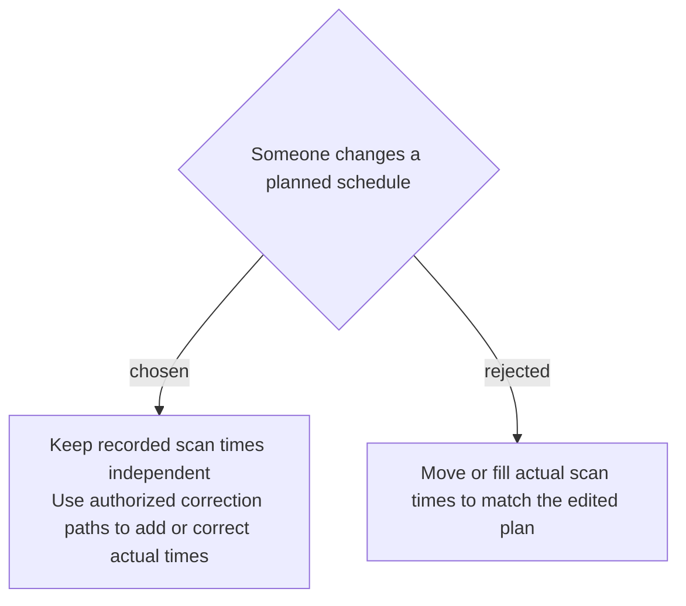

# Schedule edits do not rewrite actual scan times

On 2026-11-17 the owner accepted the schedule-history set: editing a planned schedule must not change recorded actual scan times or fill missing actual times automatically. Keep the plan and recorded facts distinguishable when reviewing past dates.

Adding or correcting actual attendance times still follows [0051](facility-0051-admin-corrections-and-audit-log.md) and the narrowly accepted Supervisor missing-time permission in [0154](facility-0154-supervisor-may-fill-missing-team-attendance-with-reason.md), with the applicable reason and provenance. This decision does not grant new correction rights, freeze legitimate corrections, choose retrospective schedule-edit authority, or resolve mid-shift transfers. It complements actual-versus-planned break handling in [0149](facility-0149-break-scans-record-actual-times-against-plan.md). Accepted design only; no application changes.
