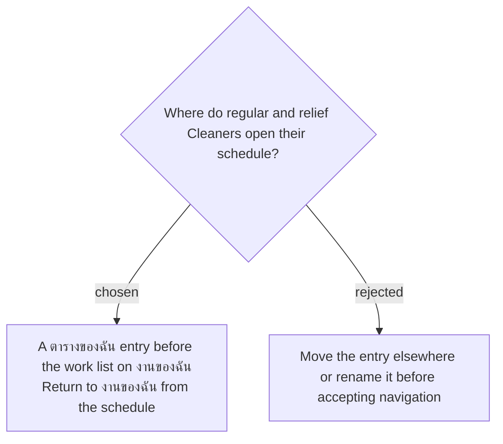

# Cleaners open their schedule before the My Work list

On 2026-11-17 the owner selected “ใช้ตำแหน่งตามแบบนี้” for the reviewed navigation set: regular and relief Cleaners use “ตารางของฉัน” before the work list on “งานของฉัน”. The schedule has a return control to My Work. Keep the personal read-only scope in [0159](facility-0159-cleaners-can-view-their-own-schedule-read-only.md).

This accepts the recommended top position, not the optional bottom-position review control. It does not change the post-login landing page, add schedule editing, expose QR tokens or select an initial date/date range. Entry access follows [0179](facility-0179-schedule-viewing-does-not-require-qr-or-gps.md). The reviewed source remains the same file referenced by [0160](facility-0160-scheduling-mockup-layout-accepted.md), revision SHA-256 `f574d3ae19b2c4e055193f07d0df2d0f077dd13f38850754edcb25be5e819bdb`. Accepted design only; no application implementation.
