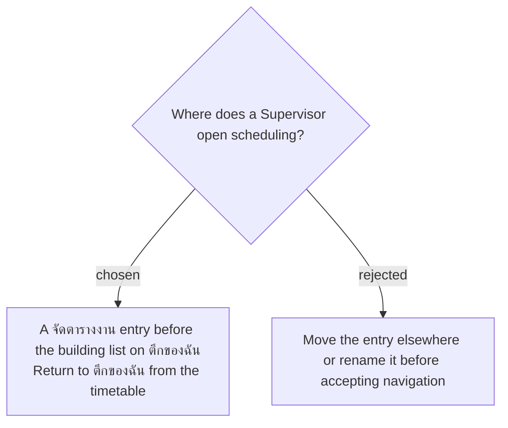

# Supervisors open scheduling before the My Building list

On 2026-11-17 the owner selected “ใช้ตำแหน่งตามแบบนี้” for the reviewed navigation set: put “จัดตารางงาน” before the building list on “ตึกของฉัน”, opening the accepted team timetable with a return control. This follows the assigned building set and own-shift authority in [0141](facility-0141-supervisor-shares-building-scope-for-view-schedule-and-inspection.md).

The entry does not change the login landing page, widen inspection rights, allow borrowing without the pending field answer, or select a default date/date range. Access follows [0179](facility-0179-schedule-viewing-does-not-require-qr-or-gps.md). Reuse the same mockup source recorded in [0160](facility-0160-scheduling-mockup-layout-accepted.md); reviewed revision SHA-256 `f574d3ae19b2c4e055193f07d0df2d0f077dd13f38850754edcb25be5e819bdb`. Accepted design only; no application implementation.
