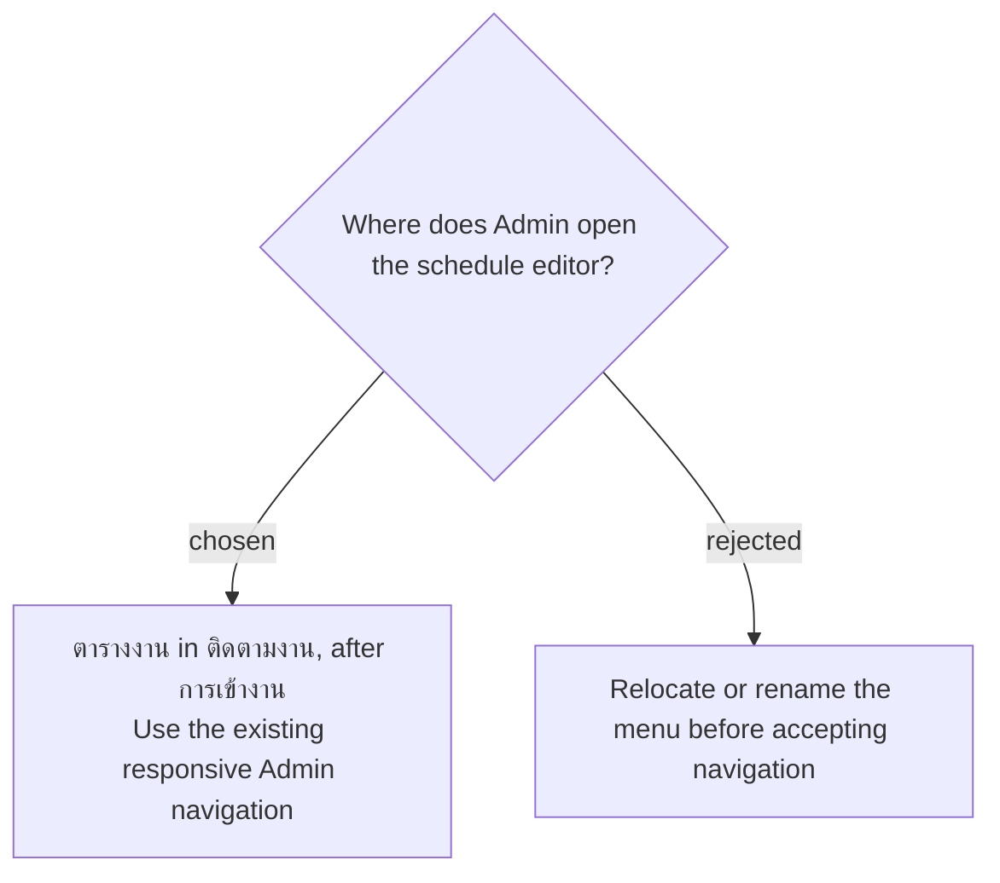

# Admin's schedule menu follows attendance

On 2026-11-17 the owner selected “ใช้ตำแหน่งตามแบบนี้” for the reviewed navigation set: add “ตารางงาน” after “การเข้างาน” in Admin's “ติดตามงาน” group. Use the existing sidebar on wide screens and wrapping navigation above the page on narrower screens. Keep Admin's accepted all-building/all-shift scheduling authority in [0133](facility-0133-admin-manages-schedules-across-buildings-and-shifts.md).

This selects navigation, not a new default landing page or an API route shape. The mockup's two sample buildings/day shift and limited interactive menu entries do not narrow Admin scope or imply that a complete Admin editor has been simulated. Access follows [0179](facility-0179-schedule-viewing-does-not-require-qr-or-gps.md). Reuse [0160](facility-0160-scheduling-mockup-layout-accepted.md)'s source; reviewed revision SHA-256 `f574d3ae19b2c4e055193f07d0df2d0f077dd13f38850754edcb25be5e819bdb`. Accepted design only; no application implementation.
