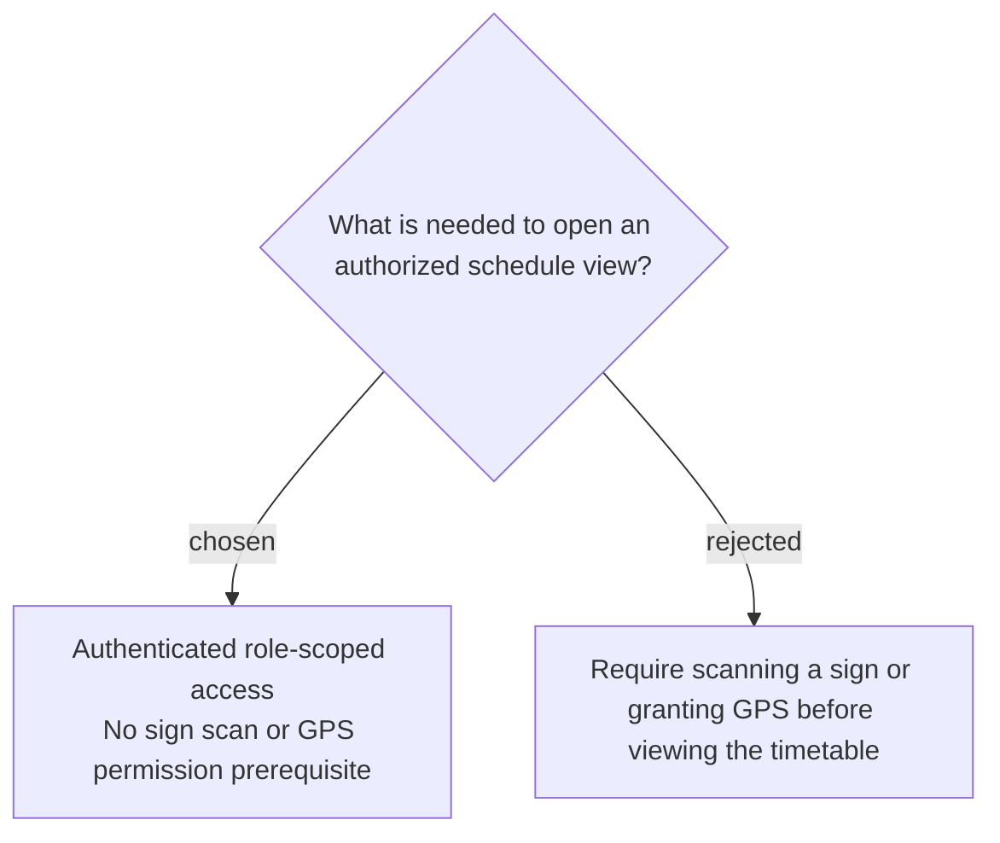

# Authorized schedule viewing does not require QR or GPS

On 2026-11-17 the owner accepted the navigation set including access after login without a QR scan or GPS permission. Regular and relief Cleaners can view only their own schedule; Supervisors and Admin retain their accepted scheduling scopes. Check these rights on the server as well as controlling menu visibility.

This is a schedule-reading rule. It does not waive QR/GPS requirements for attendance, work submission or inspection, create links to token-bearing scan pages, or require those existing callers to supply new scheduling inputs. Menu locations are recorded separately in [0176](facility-0176-cleaner-schedule-entry-precedes-work-list.md), [0177](facility-0177-supervisor-schedule-entry-precedes-building-list.md) and [0178](facility-0178-admin-schedule-menu-follows-attendance.md). Accepted design only; no application implementation.
