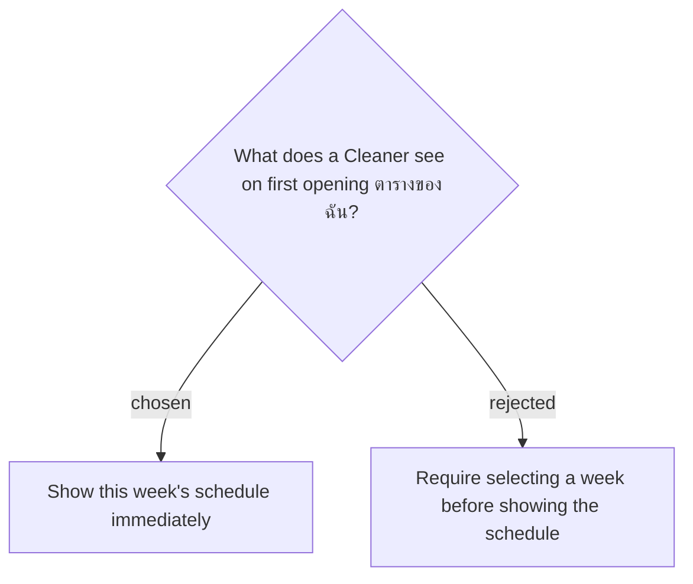

# Cleaner schedule opens the current week immediately

On 2026-11-17 the owner selected “เปิดสัปดาห์นี้ให้เลย” after a concrete re-pitch: when opening “ตารางของฉัน” on 17 November, show 16–22 November immediately rather than asking the Cleaner to choose a week first. This applies to the regular and relief Cleaner personal schedule in [0176](facility-0176-cleaner-schedule-entry-precedes-work-list.md).

The earlier combined popup about own receiving-window defaults, overnight dates, Admin defaults and return-state persistence received “งง” and was not accepted. This answer resolves only immediate current-week display on first opening. It does not accept that combined algorithm, settle the overnight week-boundary case, select Supervisor/Admin defaults or decide which week to restore after leaving and returning. Date range, retention and read scope remain unchanged. The mockup's fixed example date and 52-week cap are not approved bounds. Accepted design only; no application implementation.

Amendment 2026-11-17: [0181](facility-0181-cleaner-schedule-restores-last-viewed-week-on-return.md) resolves the return-navigation question: retain the week just viewed during the same ongoing use. The preceding return-week-pending note is superseded; first-opening current week remains unchanged.

Scope extension 2026-11-17: [0182](facility-0182-all-scheduling-roles-share-week-navigation-defaults.md) applies these week-navigation behaviors to Supervisor and Admin schedules as well. The unaccepted combined algorithm and overnight week-boundary question remain separate.

Overnight amendment 2026-11-17: [0183](facility-0183-ongoing-night-shift-keeps-its-start-week-on-first-open.md) resolves the ongoing Sunday-to-Monday night-shift case for Cleaners/Supervisors: first show the week of that shift's start date. This supersedes the preceding pending note for that case; the broader own receiving-window algorithm remains unaccepted.
