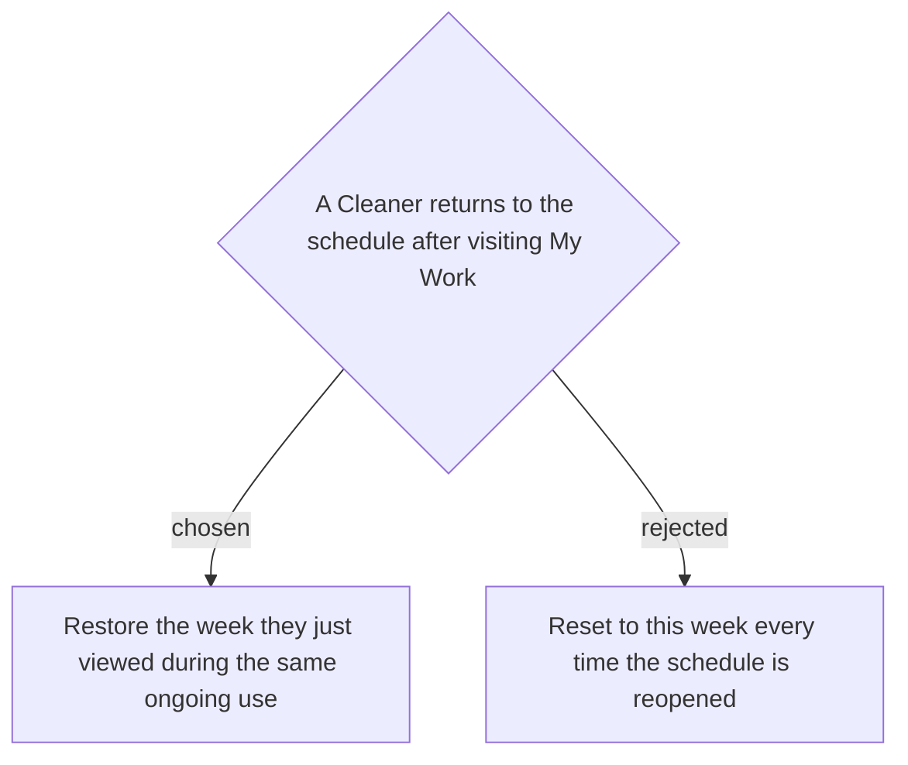

# Cleaner schedule restores the last viewed week on return

On 2026-11-17 the owner selected “จำสัปดาห์ที่เพิ่งดู”. In the concrete example, a Cleaner views next week's schedule, returns to “งานของฉัน”, then opens “ตารางของฉัน” again; the schedule returns to next week during the same ongoing use. This applies to regular and relief Cleaners.

The first opening still shows this week under [0180](facility-0180-cleaner-schedule-opens-current-week.md). This decision selects return-navigation behavior, not a storage mechanism, persistence across logout/reload/new tabs or later independent visits, or Supervisor/Admin defaults. It does not by itself select which individual day to highlight within the restored week. Accepted design only; no application implementation or new mockup revision.

Scope extension 2026-11-17: [0182](facility-0182-all-scheduling-roles-share-week-navigation-defaults.md) subsequently accepts the same return-week behavior for Supervisor and Admin. Other persistence and selected-day/filter questions remain unchosen.
