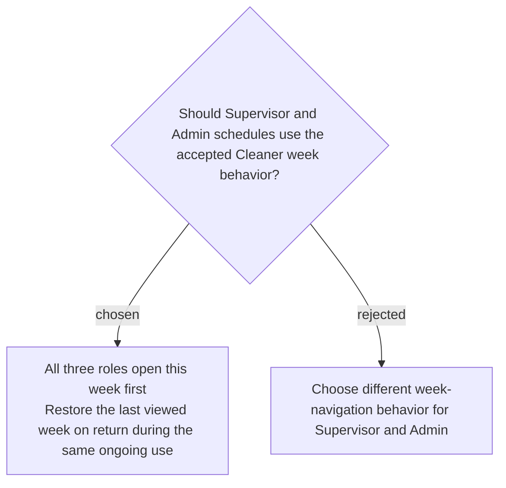

# All scheduling roles share the same week-navigation defaults

On 2026-11-17 the owner selected “ใช้แบบเดียวกัน”: extend the two accepted Cleaner behaviors to Supervisor and Admin scheduling. On first opening, show this week's timetable immediately; after navigating to another page and returning during the same ongoing use, restore the week just viewed. Regular and relief Cleaners retain the same behavior under [0180](facility-0180-cleaner-schedule-opens-current-week.md) and [0181](facility-0181-cleaner-schedule-restores-last-viewed-week-on-return.md).

This accepts shared week navigation only. It does not approve the earlier combined own receiving-window algorithm, determine building/day/shift defaults or their restoration, select persistence across logout/reload/new tabs, or settle the overnight Sunday-to-Monday week-boundary case. Existing role scopes remain; Admin still manages all buildings/shifts and Supervisors only their assigned building set/shift. Accepted design only; no application implementation or mockup revision.

Overnight amendment 2026-11-17: [0183](facility-0183-ongoing-night-shift-keeps-its-start-week-on-first-open.md) subsequently resolves the first-opening week for a Cleaner/Supervisor's ongoing night shift crossing into Monday. It does not change deliberate week restoration or decide Admin's initial shift filter.

Admin amendment 2026-11-17: [0184](facility-0184-admin-schedule-starts-all-buildings-current-shift.md) selects all buildings and the current clock shift on Admin's first opening, using that slot's start date/week for overnight shifts. Return-week behavior stays as accepted; return filter restoration remains separate.

Filter-restoration amendment 2026-11-17: [0185](facility-0185-scheduling-restores-building-and-shift-filters-on-return.md) subsequently accepts restoring applicable building/shift filters with the week for Supervisor/Admin during the same ongoing use. It does not widen Supervisor shift scope or choose persistence across logout/reload/new tabs.
