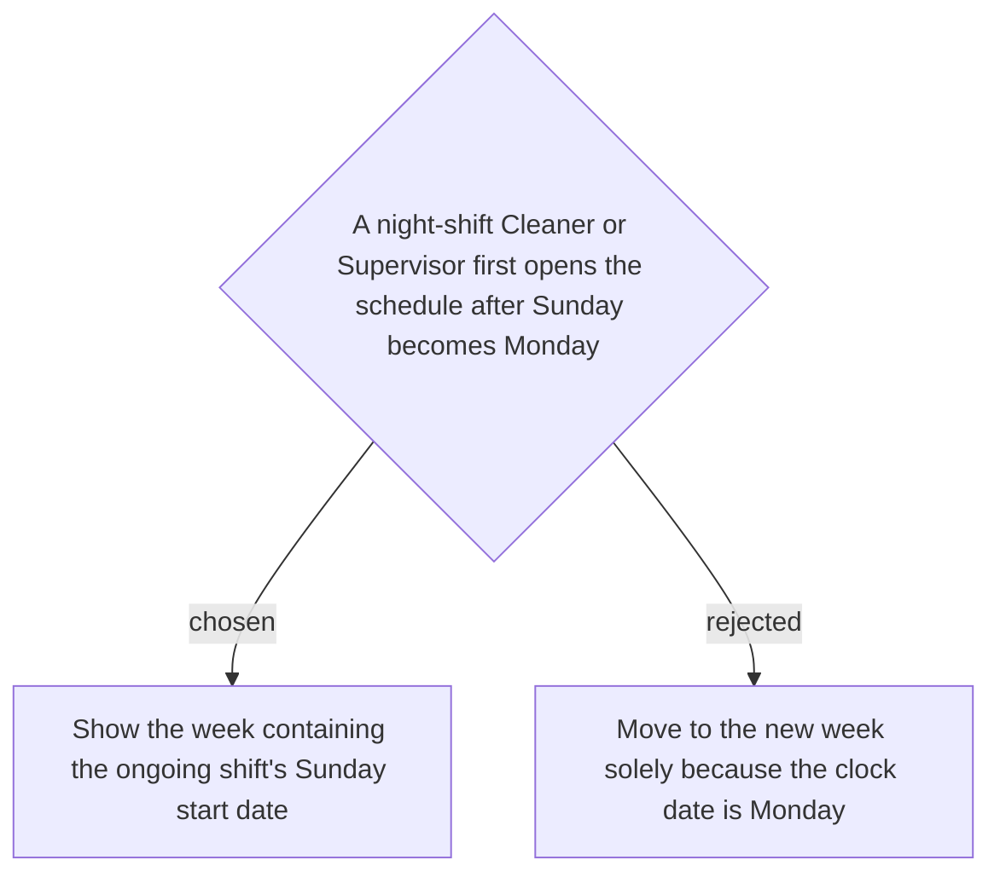

# An ongoing night shift keeps its start week on first opening

On 2026-11-17 the owner selected “เห็นสัปดาห์ของกะที่กำลังทำ”. For a Cleaner or Supervisor working the night shift from Sunday 19:00 to Monday 07:00, first opening the schedule at 02:00 Monday should show the week containing that Sunday's shift start, so the ongoing shift remains visible. In the discussed example, that is 16–22 November rather than 23–29 November.

This is an initial-week exception to [0180](facility-0180-cleaner-schedule-opens-current-week.md) and [0182](facility-0182-all-scheduling-roles-share-week-navigation-defaults.md), consistent with the existing night-shift start-date attribution. It does not override a deliberately chosen/restored week under [0181](facility-0181-cleaner-schedule-restores-last-viewed-week-on-return.md). It does not change attendance or inspection eligibility, select the after-shift receiving-window case or Admin's initial shift filter, or approve the earlier combined own-window algorithm. Accepted design only; no application implementation or mockup revision.
