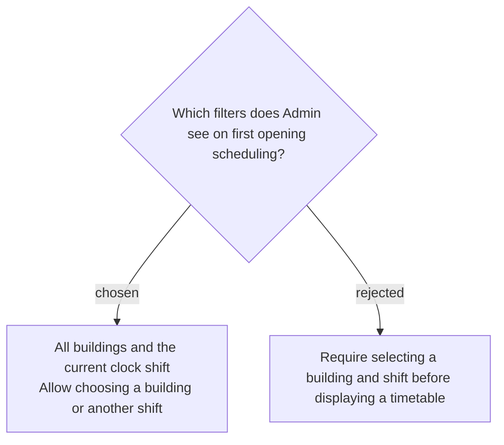

# Admin scheduling starts with all buildings in the current shift

On 2026-11-17 the owner selected “เริ่มทุกตึกของกะปัจจุบัน”. On first opening Admin scheduling, show all buildings for the current shift by the clock; for example, at 10:00 show the day-shift schedules across buildings. Admin can then filter to a building or choose another shift. “Current” refers to the scheduled clock slot, not evidence that everyone has checked in.

The accepted question also specifies the night shift's start date, as in the preceding overnight example. Therefore the initial Admin week contains the current clock slot's start date, including a Sunday-start night shift after midnight Monday; this aligns with the visible ongoing-shift principle in [0183](facility-0183-ongoing-night-shift-keeps-its-start-week-on-first-open.md). It refines the generic first-opening week rule in [0182](facility-0182-all-scheduling-roles-share-week-navigation-defaults.md) for this initial Admin selection, without overriding a deliberately selected/restored week.

Admin's all-building/all-shift authority remains under [0133](facility-0133-admin-manages-schedules-across-buildings-and-shifts.md). This chooses first-opening view filters only; returning filter state, Supervisor defaults and persistence across logout/reload/new tabs are not chosen here. It does not resolve relief ownership or any pending field policy. Accepted design only; no application implementation or mockup revision.

Amendment 2026-11-17: [0185](facility-0185-scheduling-restores-building-and-shift-filters-on-return.md) subsequently resolves returning filter state: restore the authorized building/shift selection during the same ongoing use. The initial all-buildings/current-clock-shift behavior applies when no return selection is being restored.
