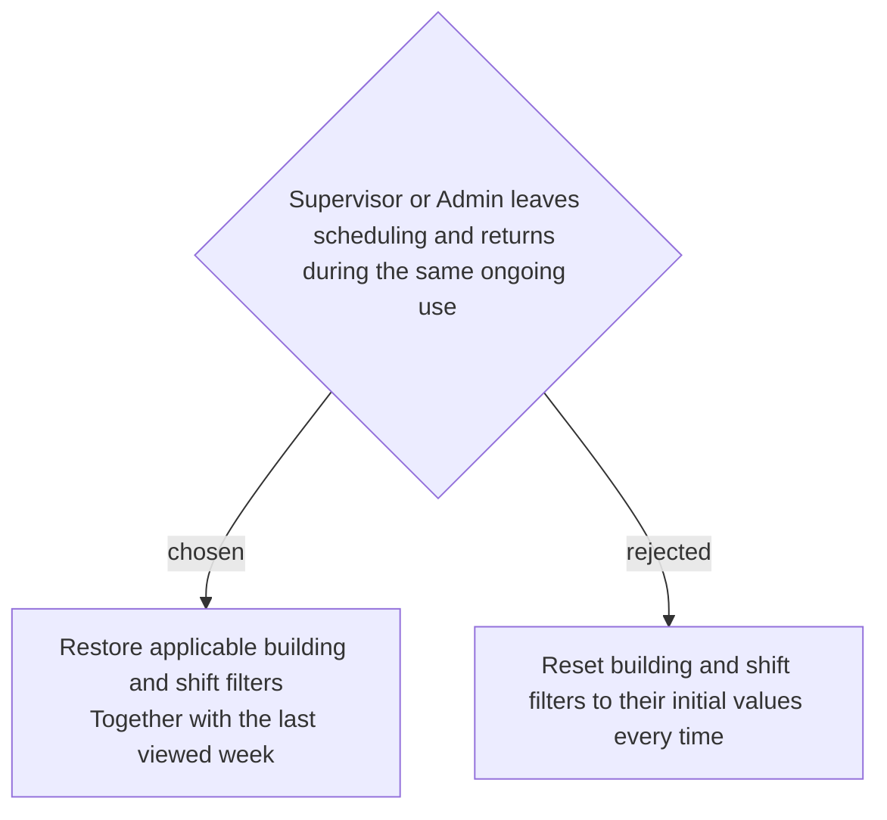

# Scheduling restores building and shift filters on return

On 2026-11-17 the owner selected “จำตึกและกะที่เพิ่งดู”. When Supervisor or Admin returns to scheduling from another page during the same ongoing use, retain the applicable building/shift filters together with the week already retained under [0181](facility-0181-cleaner-schedule-restores-last-viewed-week-on-return.md) and [0182](facility-0182-all-scheduling-roles-share-week-navigation-defaults.md). The concrete example restores Admin's “building B, night shift, next week”.

This preserves selection, not authority. A Supervisor remains in their own assigned building set and shift; the answer does not introduce a Supervisor shift-switching permission. Server authorization remains applicable to every read/write, including restored selections. Initial Admin filters still follow [0184](facility-0184-admin-schedule-starts-all-buildings-current-shift.md) when there is no return selection.

This does not choose persistence across logout/reload/new tabs or later independent visits, restore a specific selected day, or decide Supervisor's initial building filter. No storage mechanism is selected. Accepted design only; no application implementation or mockup revision.

**Persistence scope resolved:** [0218](facility-0218-schedule-return-memory-is-limited-to-ongoing-use.md) confines restoration to ongoing use; reload/new login/new tab use initial defaults. No durable saved-filter feature is added.
