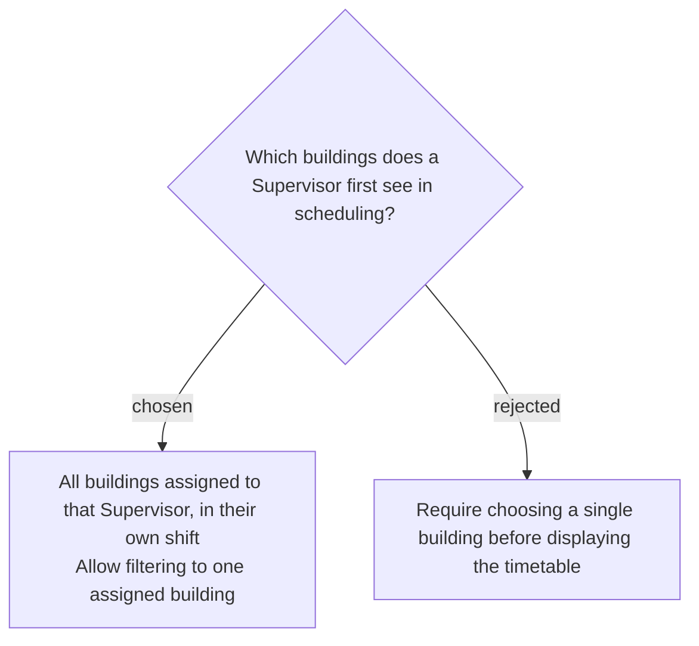

# Supervisor scheduling starts with all assigned buildings

On 2026-11-17 the owner selected “เห็นทุกตึกที่รับผิดชอบก่อน”. On first opening “จัดตารางงาน”, show the schedules of all buildings assigned to that Supervisor within their own shift. For example, a Supervisor responsible for A and B initially sees both and may then filter to A or B.

This chooses an initial filter within the building-set/shift authority in [0140](facility-0140-supervisor-may-schedule-multiple-assigned-buildings.md) and [0141](facility-0141-supervisor-shares-building-scope-for-view-schedule-and-inspection.md). It does not grant access to other buildings/shifts or answer the relief-pool/borrowing question. A retained return selection under [0185](facility-0185-scheduling-restores-building-and-shift-filters-on-return.md) takes precedence over this first-opening default. Week selection follows [0182](facility-0182-all-scheduling-roles-share-week-navigation-defaults.md) and the ongoing overnight exception in [0183](facility-0183-ongoing-night-shift-keeps-its-start-week-on-first-open.md). Accepted design only; no application implementation or mockup revision.
