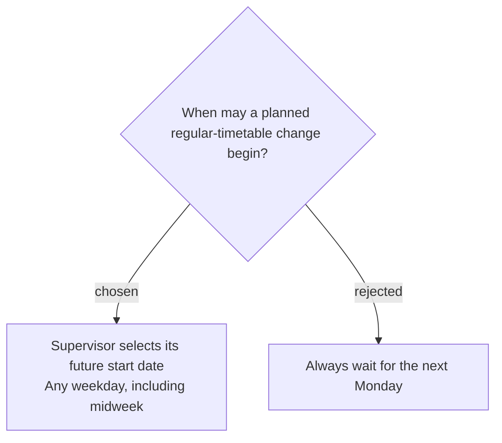

# Regular timetable changes have a selected future start date

On 2026-11-17 the owner selected “เลือกวันเริ่มใช้เองได้ (แนะนำ)”. In the regular-Cleaner timetable editor, the Supervisor can choose the future date when the changed regular timetable starts. For example, an A102 → A104 move intended for Wednesday 25 November 2026 may start on that date rather than wait for the next Monday. The regular timetable then repeats from its selected start date, subject to separately resolved dated exceptions.

Earlier dated schedules remain under [0173](facility-0173-later-timetable-changes-preserve-earlier-schedules.md), and actual scan times remain under [0175](facility-0175-schedule-edits-do-not-rewrite-actual-scan-times.md). This resolves only the future start-date choice for the proposed regular-Cleaner baseline editor. It does not authorize or prohibit retrospective corrections or same-day changes, select an ongoing-shift freeze rule, resolve conflicts with existing future dated exceptions or later timetable revisions, or approve the complete editor layout. Existing scheduling authority is unchanged; no new building, shift or relief-pool access is granted. The mockup's date bounds are illustrative, not an accepted lead-time or maximum planning horizon. Accepted design only; no application, schema, database or runtime changes.

**Subsequent clarification:** [0188](facility-0188-regular-timetable-editor-reviews-changes-before-save.md) separately accepts the shown regular-Cleaner editor layout and review-before-save sequence. The unresolved policies above remain unresolved.

**Dated-break clarification:** [0189](facility-0189-regular-break-changes-preserve-dated-break-overrides.md) now resolves the applicable regular-Cleaner first-break case: keep an explicit dated override when the default group changes. It does not settle the other future dated-exception conflicts listed above.
