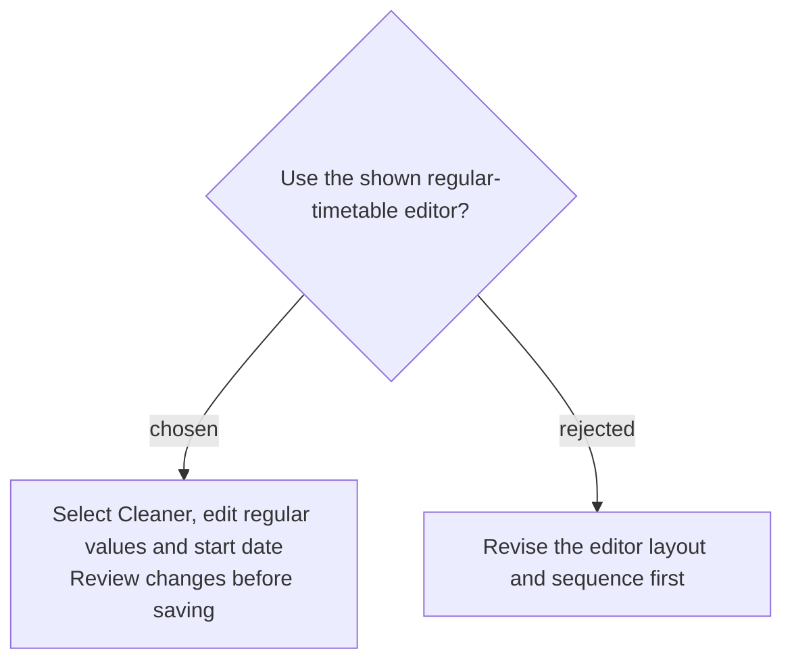

# Regular timetable editor reviews changes before saving

On 2026-11-17 the owner selected “ใช้หน้าจอตามนี้ (แนะนำ)”. Use the reviewed regular-Cleaner editor sequence: select the Cleaner → edit regular Area, recurring weekly day off and default first-break group → choose the start date → review the change summary before saving. The review makes the changed values and start date visible. Future start-date selection follows [0187](facility-0187-regular-timetable-has-a-selected-future-start-date.md).

This extends the scheduling layout in [0160](facility-0160-scheduling-mockup-layout-accepted.md). The reviewed source is `/Users/macbookair/.codex/visualizations/2026/11/16/01a1e35a-cb6e-7920-87dc-50ada17b12f4/facility-scheduling.html`, SHA-256 `d0b0660cc3d55beb1c3acd286caf4fa046c5709a0e08afc84035e921773f68b7`; reuse that same source. It shows the editor, a before/after review and return-to-edit preserving input. “ลองบันทึกในตัวอย่าง” changes synthetic data only.

This accepts the shown layout and sequence, not every demonstration constraint. The limited Area choices, date bounds, fixed example shift/week and prototype stop on existing future dated exceptions are not accepted business rules. Dated-exception precedence, later timetable revisions, retrospective/same-day changes, ongoing-shift freezing, relief editing and the five field-workflow topics remain unresolved. Existing authority and read-only Cleaner access remain. This is not the final decision recap, spec/plan approval or permission to implement. No application, schema, database or runtime changes.

**Subsequent clarification:** [0189](facility-0189-regular-break-changes-preserve-dated-break-overrides.md) resolves one dated-exception case: applicable explicit first-break overrides for regular Cleaners survive a new default break group. Other exception interactions remain unresolved; the prototype's blanket stop has not yet been revised.

**Day-off requirement amended:** [0190](facility-0190-supervisor-selects-cleaner-days-off-by-week.md) allows the Supervisor to choose different days off by week. The repeating weekday control in this preview is insufficient as the only day-off editor and needs design review. This does not revoke the general select/edit/start-date/review sequence or choose copying/default behavior between weeks.

**Day-off layout resolved:** [0191](facility-0191-weekly-days-off-use-the-multi-person-roster-layout.md) selects a weekly multi-person roster for day-off choices, with previous-week references and review before saving. The Area/break baseline editor's general sequence remains; day-off editing no longer relies on its former repeating weekday control or the proposed one-person day-off page.
