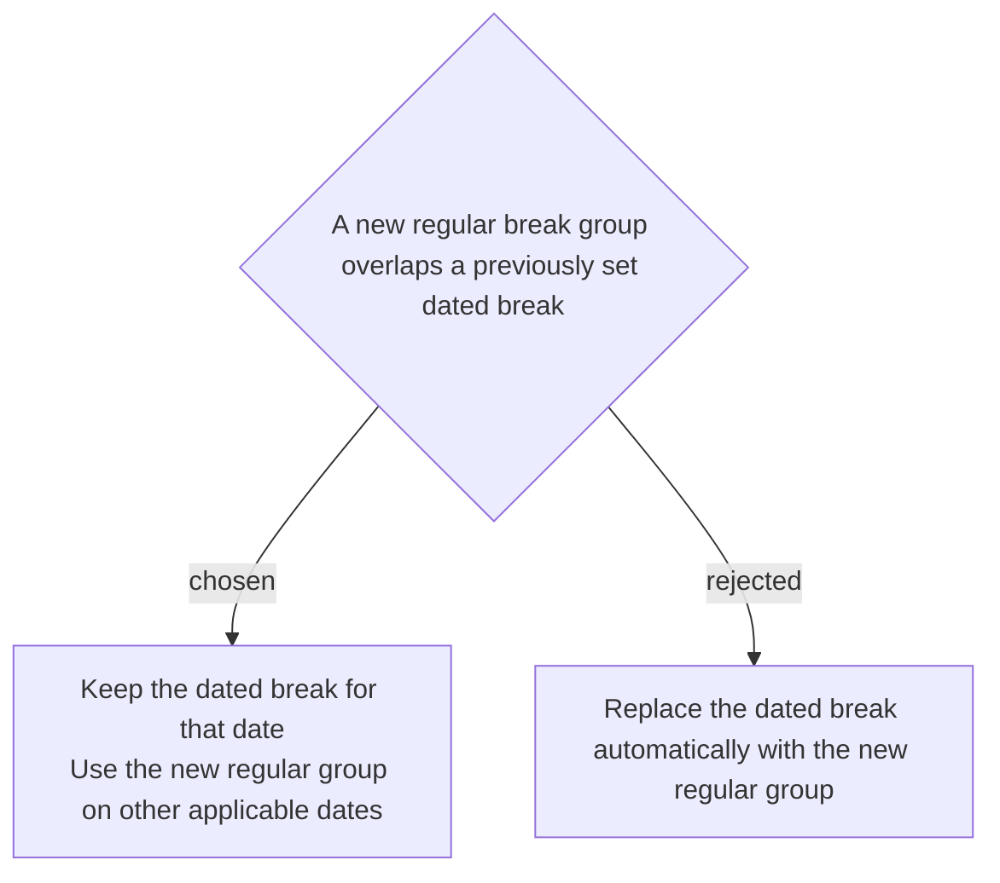

# Regular break-group changes preserve dated break overrides

On 2026-11-17 the owner selected “เก็บวันที่ 25 ไว้ที่ 11:00–12:00 (แนะนำ)” after a simpler explanation separating the regular-timetable editor from the selected-date editor. When a regular Cleaner's new default first-break group starts on 23 November, a previously explicit 25 November-only break of 11:00–12:00 remains at that time, even if the new regular group is 10:00–11:00. Other applicable dates use the new regular group. Saving the new default does not automatically erase the dated break override.

This clarifies how the dated changes in [0151](facility-0151-regular-cleaners-have-default-break-groups-with-dated-changes.md) interact with a future baseline change under [0187](facility-0187-regular-timetable-has-a-selected-future-start-date.md). The example concerns regular-Cleaner first-break settings that remain applicable to a working date. It does not settle a newly conflicting day off, leave, Area assignment, later baseline revision, relief inheritance or post-start/retrospective correction. The shared second break and actual scan times remain unchanged. The earlier “งงหมายถึงยังไงครับ” was not a selection; this decision records the subsequent explicit answer. Accepted design only; no application, schema, database or runtime changes. The mockup has not yet been revised to remove its blanket stop on future dated exceptions.

**Later mockup alignment:** the 0190 weekly-day-off proposal revision now permits a pure regular break-group change while preserving explicit group overrides on working dates. It still stops the simulation for Area changes, leave or non-working-date conflicts. Chromium verified that 25 November keeps 11:00–12:00 while another working date uses the new regular 10:00–11:00 group. This is synthetic mockup behavior, not application implementation.
