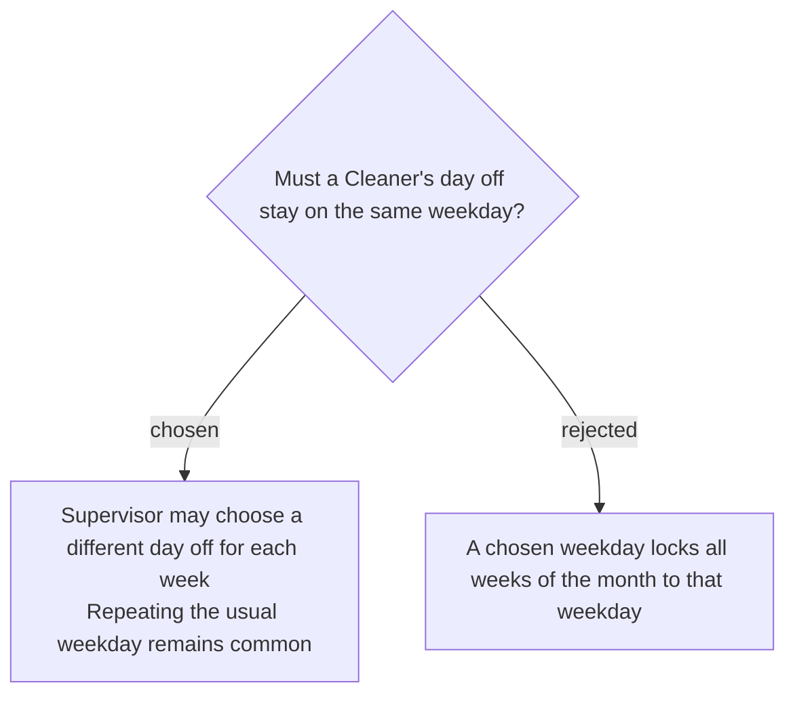

# Supervisor selects Cleaner days off by week

On 2026-11-17 the owner clarified actual practice: the Supervisor uses an A4 roster with Cleaner names and arranges days off by week. Cleaner A may be off on Monday in week 1 and Tuesday in week 2, according to the Supervisor's choice. The same weekday is often reused, but it is not mandatory for every week of the month. The scheduling interface must support these week-specific choices.

This supersedes the fixed-weekday-only restriction and exclusion of variable weekly choices in [0135](facility-0135-cleaners-have-recurring-weekly-days-off.md). It does not reject repeated patterns when the Supervisor wants them. A single repeating weekday field is therefore insufficient as the only day-off editing surface. The affected day-off portion of the editor accepted in [0188](facility-0188-regular-timetable-editor-reviews-changes-before-save.md) needs review; its general review-before-save sequence and the other accepted scheduling navigation remain.

This clarification does not choose automatic copying between weeks, whether a default/template remains, a month view, paper import/printing/export, a storage shape, the number of days off, or after-start/retrospective change rules. The A4 description is reported practice, not permission to add a paper feature or infer the sheet's remaining fields. Area work remains required when its regular Cleaner is off under [0136](facility-0136-regular-day-off-keeps-all-area-cleaning-rounds.md); relief coordination and the five field topics remain unresolved. It does not change planned breaks, the dated-break precedence in [0189](facility-0189-regular-break-changes-preserve-dated-break-overrides.md), or actual scan times. Accepted requirement clarification only; no application, schema, database, runtime or mockup changes.

**Subsequent design proposal in the same session:** revised the same canonical mockup to show a weekly day-off editor, prior-week reference and review before a synthetic week-only save. Removed the lone repeating-day-off field from the Area/break baseline editor. Current source SHA-256 is `3a8fe503faad1e4e89b5dfdccdfb7f8484fff3d329cd395e1d1b9831c69ae6c7`. This proposed UI still awaits review; its single-day selection, fixture values, demonstration date limits and separation into another page are not accepted product rules. No application implementation follows.

**Layout resolved:** after comparison screenshots, [0191](facility-0191-weekly-days-off-use-the-multi-person-roster-layout.md) selects the multi-person roster instead of one-person-at-a-time editing as the primary day-off layout. The copying/default and other unresolved policies above remain open.

**Manual reuse resolved:** [0192](facility-0192-weekly-days-off-have-an-explicit-copy-previous-week-action.md) selects a button the Supervisor presses to reuse the previous week's day-off choices and then adjust the target week. Automatic defaults and handling existing target choices remain unchosen.
