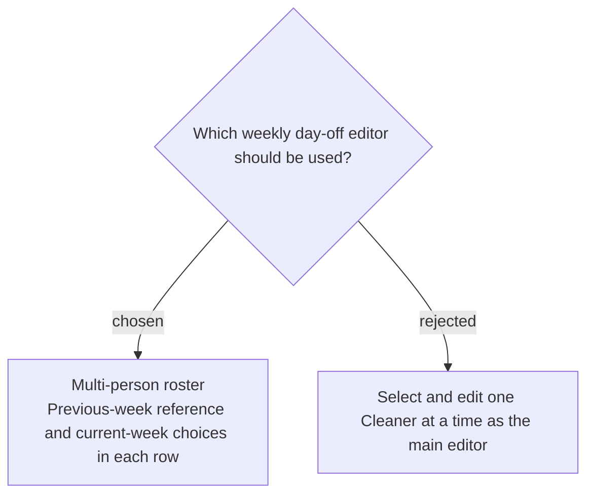

# Weekly days off use the multi-person roster layout

On 2026-11-17, after the inline preview could not open and both alternatives were shown as static screenshots, the owner selected “2 แบบที่สอง”: **ตารางรวมรายคน**. Use the multi-person roster for weekly day-off editing. The Supervisor selects a week, sees several Cleaner names together with their previous-week days off, and selects the current week's day off in each person's row. Keep the shown review of changed people before saving, consistent with the review-before-save sequence in [0188](facility-0188-regular-timetable-editor-reviews-changes-before-save.md).

This resolves the day-off layout review following [0190](facility-0190-supervisor-selects-cleaner-days-off-by-week.md), which permits different days off in different weeks. The reviewed same-source comparison was `/Users/macbookair/.codex/visualizations/2026/11/16/01a1e35a-cb6e-7920-87dc-50ada17b12f4/facility-scheduling.html`, SHA-256 `08a119eec562b945b346c0cf3cecb18950bf34cd224c50afa166accea63452a1`; the selected screenshot is this chat's `dayoff-comparison-qa/mockup-roster.png`. Reuse the canonical source for later revisions. The one-person editor is not the selected primary day-off layout; no requirement for a second supported editing mode follows from retaining it as comparison material.

This is layout acceptance, not confirmation of a mandatory single-day-off count, automatic copying/defaults between weeks, the preview's date limits or fixture headcount, batch/API atomicity, retrospective/post-start changes, or automatic relief reassignment. Existing building/shift authority, the five field topics and final recap/spec/plan gates remain unchanged. No application, schema, database, runtime or publication change is authorized by this choice.

**Subsequent choice:** [0192](facility-0192-weekly-days-off-have-an-explicit-copy-previous-week-action.md) adds an explicit Supervisor-triggered “คัดลอกวันหยุดจากสัปดาห์ก่อน” action, followed by edits and review before saving. This is not automatic copying on entry; existing target-choice handling remains open.
