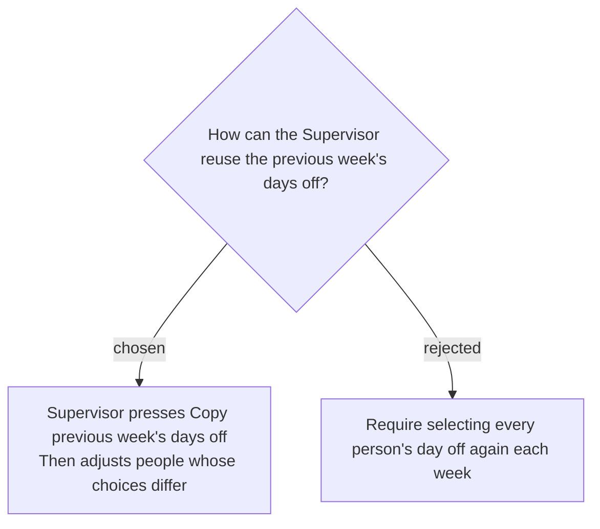

# Weekly days off have an explicit copy-previous-week action

On 2026-11-17 the owner selected “มีปุ่มคัดลอก (แนะนำ)”. Add **“คัดลอกวันหยุดจากสัปดาห์ก่อน”** to the weekly multi-person roster selected in [0191](facility-0191-weekly-days-off-use-the-multi-person-roster-layout.md). The Supervisor explicitly presses it when arranging a new week, then changes the people whose days off differ. This reduces repeated entry because the owner reports that the same weekday is common even though [0190](facility-0190-supervisor-selects-cleaner-days-off-by-week.md) permits different choices by week.

Copy the day-off choices into the target week's editable roster; they concern that week's dates, not the prior week's literal dates. Keep review before saving under [0191](facility-0191-weekly-days-off-use-the-multi-person-roster-layout.md). This does not select automatic copying on opening a week or immediate saving when the button is pressed. Only day-off choices are covered; it does not copy leave, Area/break changes, relief assignments or actual scan times, nor widen authorized building/shift scope.

The treatment of already saved or locally edited target-week choices, a missing source choice or changed staff membership still needs definition. A mandatory day-off count, batch/API atomicity, retrospective/post-start changes and the five field topics remain unresolved. This records the feature choice only; the mockup does not yet contain the button. No application, schema, database, runtime or publication changes.

**Target-choice handling resolved:** [0193](facility-0193-copy-previous-week-days-off-fills-only-unset-choices.md) preserves choices already entered in the target week and fills only people without a choice. Source gaps, membership differences and the remaining policies above are still open.

**Mockup follow-through:** the same-session 0193 revision now shows and simulates this button in the selected roster. It changes only local editable choices until review/save. This does not mean the application has been implemented.
