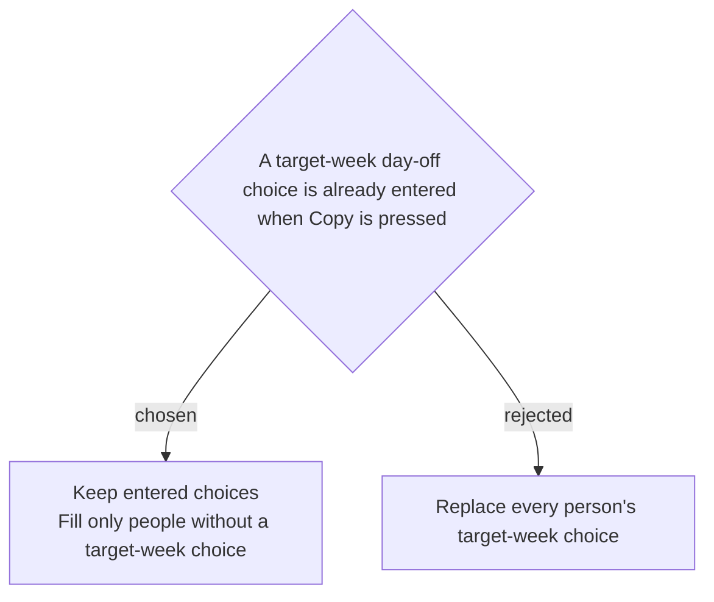

# Copying previous-week days off fills only unset choices

On 2026-11-17 the owner selected “เติมเฉพาะคนที่ยังไม่ได้เลือก (แนะนำ)”. The explicit prior-week-copy action in [0192](facility-0192-weekly-days-off-have-an-explicit-copy-previous-week-action.md) fills only people who do not yet have a day-off choice in the target week. If Cleaner 01 already has a target-week choice, copying keeps that choice rather than replacing it with the previous week's weekday.

Protect choices already visible in the target editor, including current local selections; saving a selection first is not a prerequisite for keeping it. This is consistent with preserving local input under [0171](facility-0171-schedule-refresh-preserves-unsaved-input.md). Copied choices remain editable and go through review before saving under [0191](facility-0191-weekly-days-off-use-the-multi-person-roster-layout.md) and 0192. Copying alone does not save, erase or change the source week, or copy leave, Area/break data, relief assignments or actual scan times.

This decides target-choice precedence only. Missing source choices, changed staff membership, mandatory day-off count, partial-roster save/publication policy, batch/API atomicity and post-start/retrospective rules remain unresolved. Existing authority and the five field questions remain. Accepted design only; no application, schema, database, runtime or publication changes.

**Mockup aligned in the same session:** the canonical source now includes the explicit copy button and empty row choices. A synthetic target week of 30 November–6 December has Cleaner 01 already set to Wednesday and other rows unset. Copy fills only empty choices; it also preserves an unsaved local selection for Cleaner 02. Copied values remain editable, cancellation restores saved choices and review/save is separate. Current source SHA-256 is `71475c9c793cb9d8455571294e7d622acec54a6196af0ad54a7ade5a3e0335ce`. This fixture does not select initialization/defaults for all future weeks or a partial-roster publication policy. Static PNGs are the owner's review surface because their inline preview could not open.

**Closeout accepted:** [0210](facility-0210-copy-days-off-by-identity-with-visible-source-gaps.md) resolves stable-ID matching and missing sources; [0208](facility-0208-save-incomplete-rosters-with-visible-gaps.md)/[0209](facility-0209-schedule-batches-save-atomically.md) allow visibly incomplete roster saves with atomic submitted rows; [0217](facility-0217-no-invented-day-off-quota-or-automatic-week-defaults.md) prohibits invented quota/defaults. This supersedes those pending-policy notes above.
