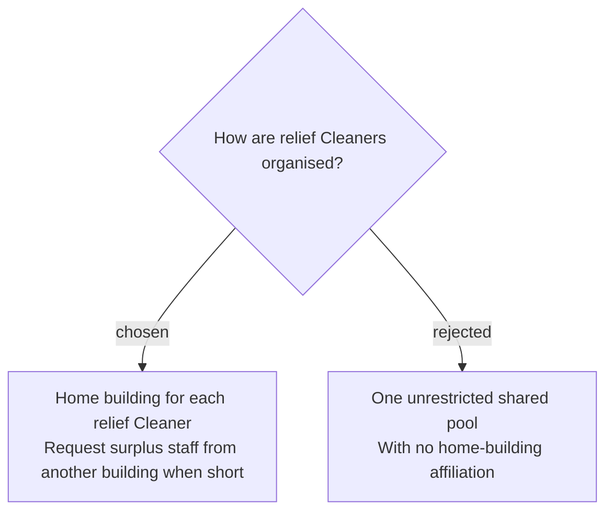

# Relief Cleaners have home buildings and may be requested from another building's surplus

On 2026-11-17 the owner clarified actual work: relief Cleaners are assigned to individual buildings. When one building is short and another has surplus staff, the short building requests the surplus person to cover. This resolves the home-building question left open by [0139](facility-0139-relief-cleaners-may-work-across-buildings.md). A home building is distinct from a regular Area: relief Cleaners still have no regular Area under [0137](facility-0137-dedicated-relief-cleaners-cover-days-off.md).

This confirms home-building affiliation and the existence of cross-building borrowing, not an unrestricted same-shift candidate pool. The answer does not identify who agrees to the request, who records the assignment, how surplus is determined, whether agreement happens inside the web app, or how conflicts are resolved. These details remain open within field topic 1. The regular shift and assigned-building Supervisor authority remain unchanged; borrowing does not grant authority to edit another building's schedules. No application, schema, database or runtime changes are authorised by this answer.

**Agreement authority resolved (2026-11-17):** [0206](facility-0206-source-building-supervisor-agrees-before-cross-team-relief-assignment.md) requires the source-building Supervisor to agree to release the person first; the destination Supervisor then assigns destination work. This replaces the pending-authority status above. Web versus outside-web agreement and its recording mechanism remain to be selected.
