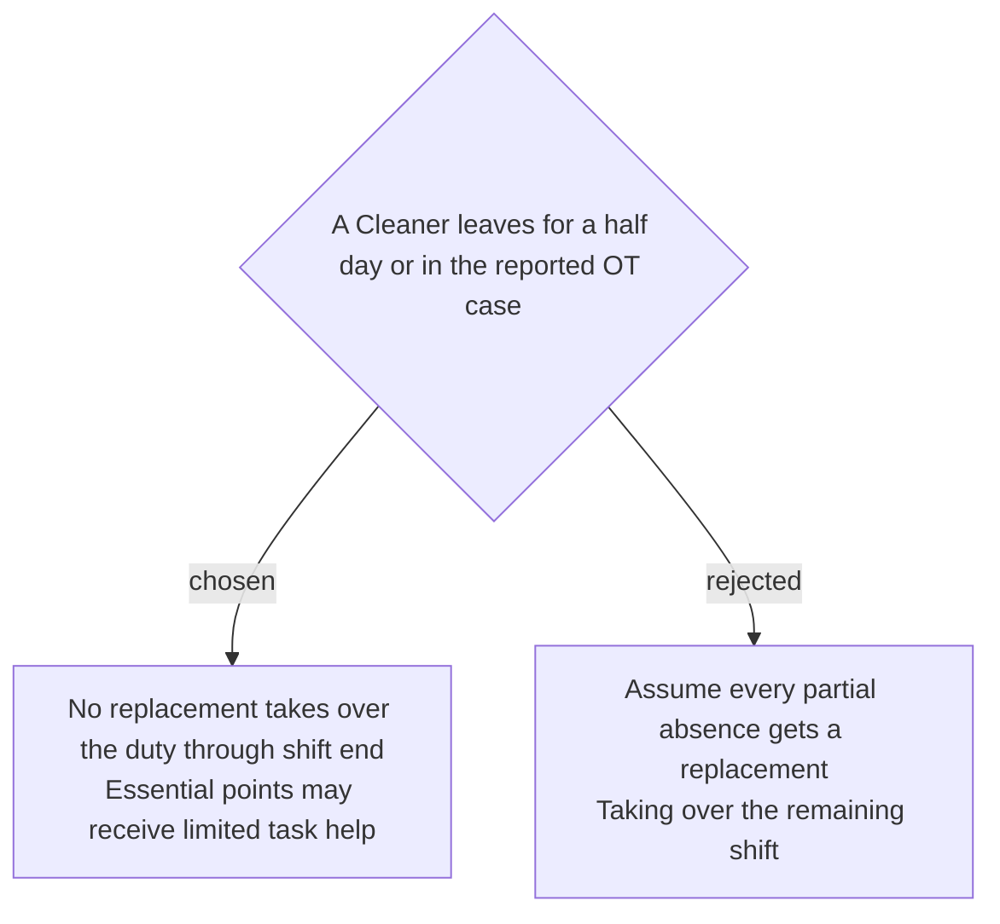

# Partial-shift departures have no replacement duty through shift end, with essential-task help

On 2026-11-17, answering field topic 2, the owner stated two distinct practices: a Cleaner assigned to replace someone works the whole shift; when someone leaves for a half day or in the described “ออก โอที” case, nobody takes over that duty for the remainder of the shift. Very essential points, such as toilets, receive help with tasks such as collecting rubbish or replenishing toilet paper until work ends. This preserves the normal whole-shift assignment under [0144](facility-0144-relief-cleaner-takes-one-area-for-the-whole-shift.md) and resolves the assumption that partial leave must have a person assigned as replacement for its remaining hours.

Limited essential-task help is not confirmation that the helper takes responsibility for the whole Area, every point or all rounds. The helper's identity, authority, QR/sign usage, recording method and any need for a new application workflow are not established. Do not automatically create a partial-shift relief assignment or repurpose the old extra-Area cover model. This does not reduce configured rounds or mark an unattended Area as covered.

Partial leave remains required under [0157](facility-0157-recorded-leave-includes-partial-shifts.md). The exact timing/meaning of the reported OT departure, applicability to other leave patterns (including leave then return), departure/return attendance and post-start reassignment remain open. Do not infer new payroll rules or a fixed OT departure time. This records the owner's reported field practice, not direct Supervisor confirmation or application implementation.
