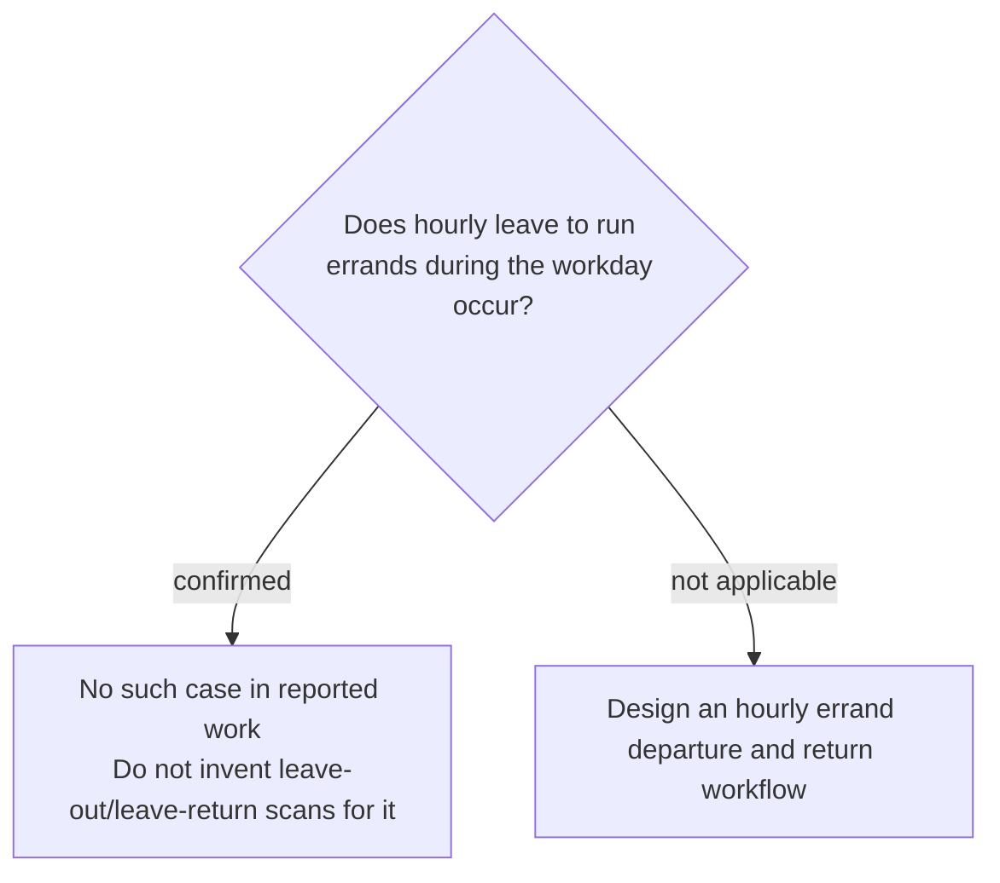

# Do not add an hourly errand leave-and-return workflow that does not occur

On 2026-11-17, answering field topic 3, the owner stated that there is no hourly leave to go out for errands during the workday. This narrows [0157](facility-0157-recorded-leave-includes-partial-shifts.md): do not require an hourly errand leave-and-return feature or extra departure/return scans for a workflow that does not occur. Full-shift and half-day leave remain in scope; do not remove partial leave entirely.

The answer did not say which attendance action is used when someone leaves for the remainder of a shift (the pending 13:00 example), nor define every possible time-limited absence or the reported OT departure. Do not infer that an early departure is unrecorded, automatically ShiftOut, or a normal break. This records the owner's field clarification; no implementation or runtime change.
