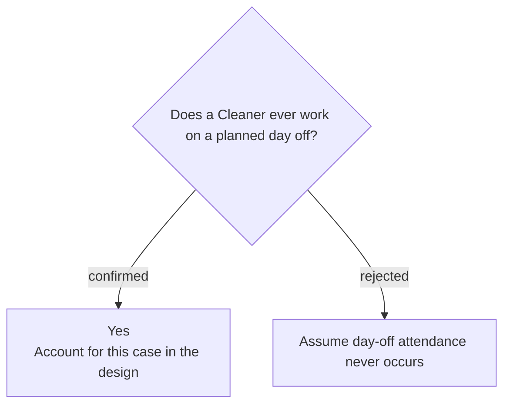

# Working on a planned day off is an actual case

On 2026-11-17, answering field topic 4, the owner confirmed that work on a day off occurs. The scheduling design must account for it rather than excluding this actual workflow.

The answer does not choose whether the schedule must change before check-in or may be corrected afterward, who authorises attendance, which Area is used when a relief Cleaner is already assigned, or what happens to that relief assignment. Do not infer automatic acceptance or rejection at the sign, automatic cancellation of the day off, reassignment or payroll/OT calculation. These details remain distinct from the confirmed existence of the case. No application changes or implementation approval.

**Web ordering resolved (2026-11-17):** [0205](facility-0205-allow-eligible-day-off-check-in-with-explicit-schedule-review.md) accepts otherwise eligible actual check-in before explicit day-off schedule adjustment, with a visible conflict for Supervisor review. No automatic day-off change or relief reassignment. This supersedes the pending-order status above; operational agreement and staffing-conflict outcomes are not inferred.
