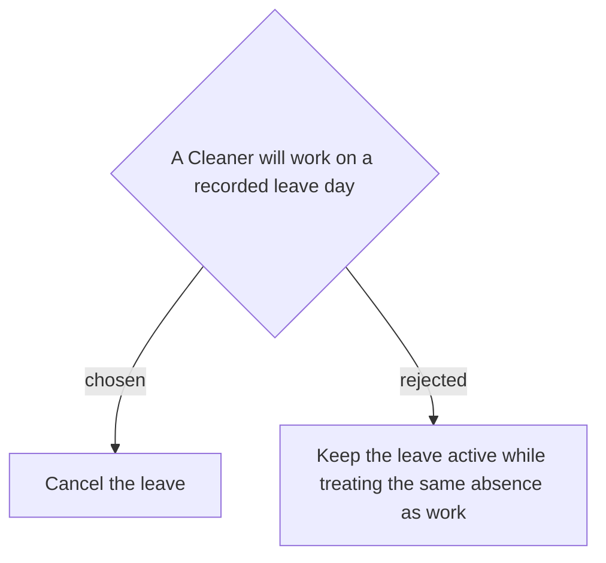

# Cancel recorded leave when the Cleaner works on that leave day

On 2026-11-17, answering field topic 4, the owner stated that if someone works on a leave day, cancel the leave. This resolves the cancellation outcome left open by [0156](facility-0156-supervisor-records-agreed-leave-without-request-workflow.md). Preserve change history rather than removing evidence that leave was previously recorded, consistent with the accepted audit/history requirements.

This does not establish whether cancellation must precede check-in, whether attendance automatically cancels leave, the exact cancellation form, or what happens to an already arranged replacement. Supervisor/Admin scope and the absence of an in-app Cleaner leave-request workflow remain unchanged. No actual scan times are rewritten to implement cancellation. No application or runtime changes.

**Ordering resolved (2026-11-17):** [0202](facility-0202-allow-eligible-check-in-before-explicit-leave-cancellation-with-visible-conflict.md) accepts otherwise eligible actual check-in before explicit cancellation, with a visible conflict and preserved timestamps. Check-in does not cancel leave or rearrange relief staff automatically. This supersedes the pending-order status above; exact form/staffing conflicts remain open.
