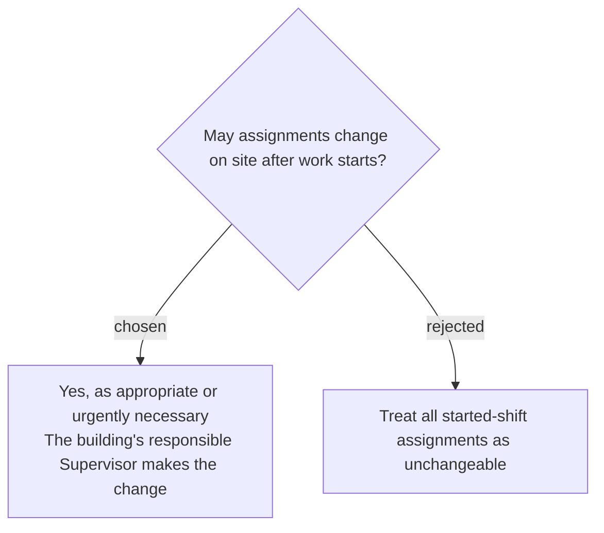

# The responsible building Supervisor may change assignments after work starts

On 2026-11-17, answering field topic 5, the owner stated that assignments may be changed on site as appropriate or for urgent necessity, and the building's responsible Supervisor makes the change. The owner also said that the incoming replacement works according to the schedule (“คนมาทำแทนก็ทำงานตามตาราง”). Preserve that statement without assuming which attendance times, sign or remaining tasks it refers to.

This resolves whether post-start changes happen and who makes the operational decision within the responsible building. It does not grant unrestricted cross-building borrowing authority (still deferred under [0194](facility-0194-relief-cleaners-have-home-buildings-with-surplus-borrowing.md)), add self-reassignment by Cleaners, permit cross-shift assignments, or grant wider Supervisor actual-time correction rights.

Do not use a blanket started-shift freeze that blocks this accepted workflow. The effective time, sign/attendance sequence for departing and incoming people, handling of existing work and helper duties still need precise definition. Existing scans remain attached to their recorded Area/time; schedule changes do not relabel prior actual work under [0175](facility-0175-schedule-edits-do-not-rewrite-actual-scan-times.md). This clarifies [0144](facility-0144-relief-cleaner-takes-one-area-for-the-whole-shift.md)'s previously open post-start case without defining a recurring multi-Area relief pattern. No implementation, schema or runtime changes.

**Transfer mechanics accepted (2026-11-17):** [0203](facility-0203-midshift-area-transfer-preserves-shift-and-break-progress.md) preserves the initial shift and break progress; [0204](facility-0204-midshift-transfer-requires-one-destination-sign-arrival-confirmation.md) uses one destination-sign arrival confirmation, distinct from another ShiftIn. This supersedes the general pending sign/attendance status above; exception/recovery and break-group details still need specification.
