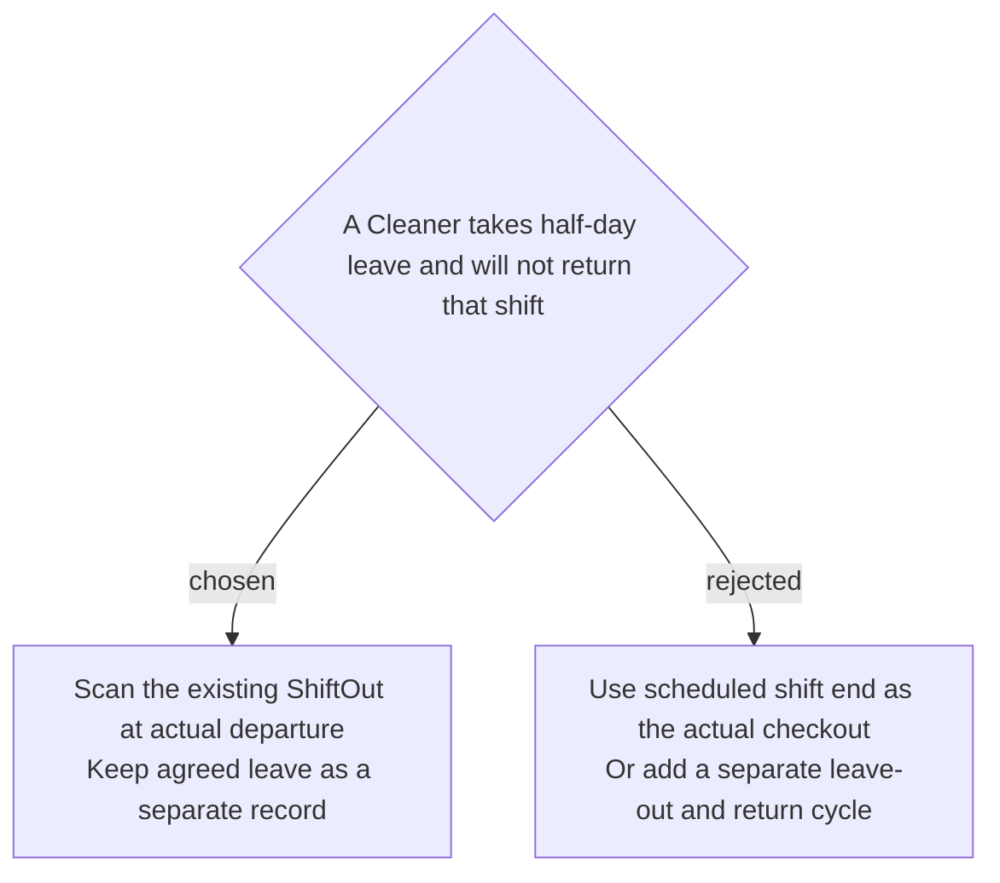

# Half-day final departure records ShiftOut at the actual departure time

On 2026-11-17 the owner accepted the recommendation after reviewing [the production-product research](../requirements-gathering/2026-11-17-half-day-departure-production-patterns.md). A Cleaner leaving for the rest of the shift uses the existing “เลิกงาน” action at the actual departure time. In the synthetic example, planned work is 07:00–19:00, agreed leave is 13:00–19:00 and the actual ShiftOut is recorded at 13:00. The example is not a fixed half-day duration or a site-wide leave-start rule.

The Supervisor's agreed-leave record and the actual attendance remain distinct. Never replace actual departure with 19:00 or generate a checkout from the leave record. ShiftOut ends further work submission for that slot under the existing ShiftIn-until-ShiftOut rule. If the scan is forgotten, do not manufacture it; existing authorised missing-time/correction rules and provenance still apply. The accepted design does not create a leave-return lifecycle for the nonexistent hourly-errand case under [0196](facility-0196-no-hourly-errand-leave-and-return-workflow.md).

This resolves final half-day departure attendance left open in [0157](facility-0157-recorded-leave-includes-partial-shifts.md). It does not define urgent Area-transfer scans, cancellation/check-in order for work on days off/leave, the exact reported OT departure time, or payroll calculations. Later breaks made inapplicable by recorded leave are addressed separately in [0201](facility-0201-leave-after-final-departure-makes-later-break-actions-inapplicable.md). Accepted design only; no application/schema/database/runtime changes or implementation approval.
