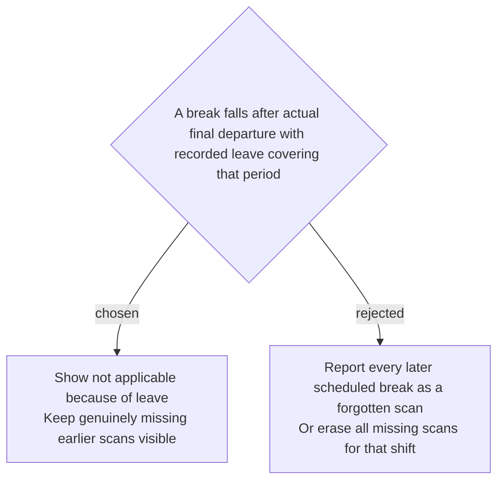

# Recorded leave after final departure makes later break actions inapplicable

On 2026-11-17 the owner accepted this detail together with actual-time final departure in [0200](facility-0200-half-day-final-departure-records-actual-shift-out.md). If a Cleaner leaves at 13:00 for recorded half-day leave, a 16:00 break action after departure is not reported as forgotten; show “ไม่ต้องลงเวลาเนื่องจากลา”. Actual attendance fields stay empty for actions that were not scanned; do not insert planned break times or fabricate events.

Genuinely missing scans before final departure remain missing and follow [0153](facility-0153-missing-break-scan-can-be-skipped-without-fabricating-time.md) and [0154](facility-0154-supervisor-may-fill-missing-team-attendance-with-reason.md). This distinguishes inapplicable actions from deliberately skipped/missing ones. It does not globally suppress missing-time indicators whenever any leave exists, assume every early checkout is authorised leave, or resolve mismatches between actual departure and the recorded leave interval. Those boundary cases need explicit spec/acceptance treatment without rewriting facts.

Preserve the old/new attendance lifecycle distinction under [0164](facility-0164-preserve-legacy-four-action-attendance-history.md): this is not a reason to invent a second break for an old four-action shift. Accepted design only; no application/schema/database/runtime changes or implementation approval.
