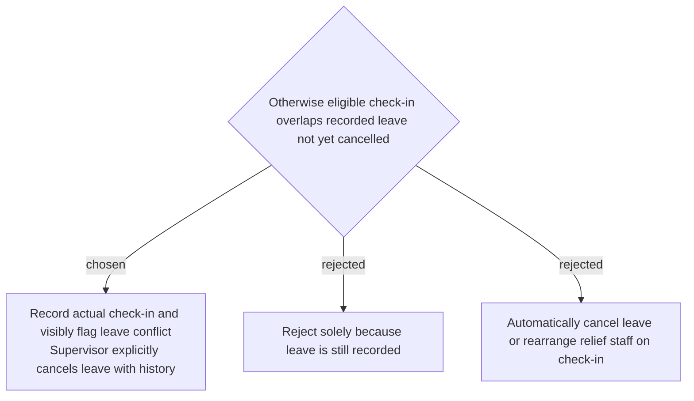

# Allow eligible check-in before explicit leave cancellation, with a visible conflict

On 2026-11-17 the owner replied “OK” to the [researched recommendation](../requirements-gathering/2026-11-17-attendance-on-recorded-leave-production-patterns.md). Cancel leave before work when known in advance, but an otherwise eligible actual check-in need not wait for web cancellation. Preserve the scan time and show “เข้างานตรงกับวันลา — รอซุปตรวจสอบ”. The responsible Supervisor (or Admin within existing authority) explicitly cancels leave under [0198](facility-0198-cancel-recorded-leave-when-working-on-that-leave-day.md); clear the conflict only after cancellation saves successfully, retaining who changed what and the attendance provenance.

Synthetic example: check-in at 07:00, leave cancellation at 07:10. Attendance stays 07:00. Check-in does not automatically cancel leave, change Area, borrow a person or move an already assigned relief Cleaner. Account, Area/sign, shift, receiving-window and other applicable eligibility checks remain. This is record-order tolerance, not a new operational permission to attend without the appropriate agreement or to access an unassigned Area.

The conflict flag is not a hidden pending-attendance state or a new submission block. Do not silently change the accepted actual-ShiftIn Area entry metrics or existing ShiftIn-until-ShiftOut work submission rule because the leave conflict remains. Staffing conflicts and disputed attendance still require their applicable authorised actions; do not delete recorded facts or grant wider Supervisor scan-overwrite rights. This decision does not automatically select the corresponding planned-day-off policy or urgent transfer sign/attendance sequence.

This amends 0198's previously unresolved cancellation/check-in ordering. The research establishes configurable product patterns, not a universal industry requirement. Accepted design only; no implementation, application/schema/database/runtime changes, deployment or publication approval.
