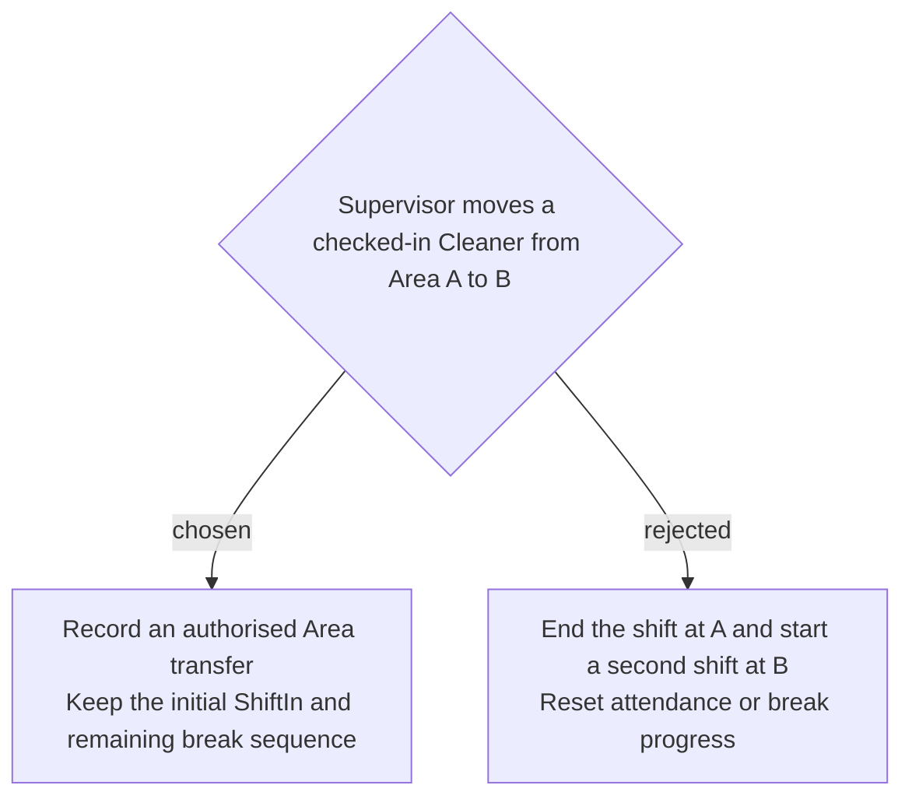

# A midshift Area transfer preserves the shift and existing break progress

On 2026-11-17 the owner replied “OK” to the [researched transfer proposal](../requirements-gathering/2026-11-17-midshift-area-transfer-production-patterns.md). The responsible Supervisor records A → B and its effective time under [0199](facility-0199-building-supervisor-may-change-assignments-after-work-starts.md). For a person already checked into that slot, moving Areas is not final ShiftOut at A followed by another ShiftIn at B. Preserve the original actual ShiftIn, slot/date/shift, and recorded break progress. Continue the remaining break actions and eventually record final ShiftOut at the then-current authorised Area.

Synthetic example: ShiftIn at A 07:00; Supervisor records a move effective 13:00; arrival at B is confirmed 13:05 under [0204](facility-0204-midshift-transfer-requires-one-destination-sign-arrival-confirmation.md); final ShiftOut at B 19:00. Preserve old scans/work at A. These are example times, not a fixed transfer duration or shift-end requirement. Do not reset breaks or reinterpret old events as having happened at B.

The normal whole-shift relief timetable under [0144](facility-0144-relief-cleaner-takes-one-area-for-the-whole-shift.md) remains; this specifies an authorised post-start exception, not a new recurring multi-Area assignment pattern. A person who has not entered work yet uses normal initial check-in, not this transfer flow. Limited essential-task help under [0195](facility-0195-partial-shift-departures-have-no-replacement-but-essential-task-help.md) is not automatically an Area responsibility transfer. Cross-building lending authority stays explicitly deferred; do not grant it through this mechanism.

Transfer during a break, a changed break group, cancellation/retry/missing arrival confirmation and staffing conflicts need explicit spec treatment consistent with these accepted boundaries. No application/schema/database/runtime changes or implementation approval.

**Closeout details:** [0212](facility-0212-area-transfer-preserves-an-in-progress-break.md) preserves an ongoing break; [0213](facility-0213-cancel-pending-transfer-or-append-after-arrival.md) defines cancellation before confirmation and append-only forward changes after arrival. These resolve the corresponding pending design branches above.
