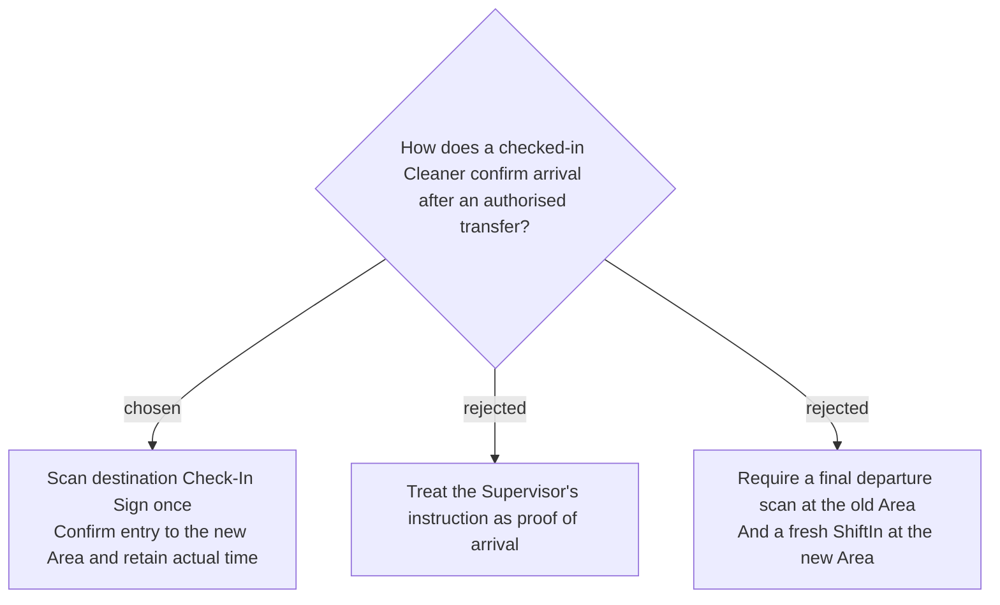

# Confirm a midshift transfer with one scan at the destination Area sign

On 2026-11-17 the owner accepted the destination-confirmation recommendation. Under [0203](facility-0203-midshift-area-transfer-preserves-shift-and-break-progress.md), the Supervisor first records the authorised Area move. On reaching B, the Cleaner scans B's existing Check-In Sign and selects “ยืนยันเข้าพื้นที่ใหม่”. This is one destination confirmation; no new origin-departure scan is required for this flow. It records an actual transfer confirmation, not a second ShiftIn or an extra mandatory action on ordinary shifts with no transfer.

Keep Supervisor effective time and actual arrival separate. In the example, the plan changes at 13:00 and B is confirmed at 13:05. Dashboard shows the move as instructed but arrival unconfirmed until the scan; do not invent arrival at 13:00. Preserve destination sign/GPS provenance and validate that the person is authorised for this pending destination transfer under the applicable account/shift/sign rules. This does not relax QR/GPS requirements, let the Cleaner select arbitrary Areas or silently borrow staff.

No origin scan means no measured physical departure time from A. Do not present plan effective time as that measurement, infer continuous physical presence/travel from it, or move old A scans/work to B. Existing entry at A remains historical evidence; confirmed arrival at B is a distinct record. The overview currently uses ShiftIn-only entry evidence and must explicitly integrate the new confirmation before transfer support goes live. Preserve the accepted categories/denominator unless separately amended; the exact aggregation/current-coverage contract must be reconciled in spec/plan rather than faking a duplicate ShiftIn. Avoid claiming simultaneous current responsibility at A and B for the same transferred person.

Accepted design only; no implementation, schema/database/runtime changes or publication approval. This narrows the transfer-mechanics pending status in [0199](facility-0199-building-supervisor-may-change-assignments-after-work-starts.md); unresolved exception/recovery cases do not authorise guessing attendance times.
