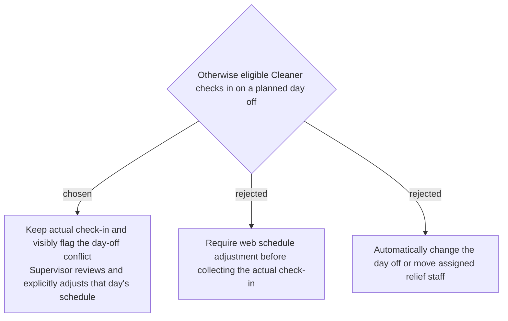

# Allow eligible day-off check-in with explicit Supervisor schedule review

On 2026-11-17 the owner selected “ใช้ตามที่แนะนำ”: apply the record-first, explicit-review pattern accepted for leave in [0202](facility-0202-allow-eligible-check-in-before-explicit-leave-cancellation-with-visible-conflict.md) to planned days off under [0197](facility-0197-working-on-a-planned-day-off-occurs.md). An otherwise eligible account may record actual check-in, with a visible conflict for the responsible Supervisor to review and explicitly adjust the schedule for that day. Preserve actual scan time and schedule-change history. Clear the conflict only after the relevant adjustment saves successfully.

Account, Area/sign, shift, receiving-window and other applicable eligibility checks still apply. This decides the order of web record updates; it does not itself authorise work in an arbitrary Area or determine who operationally agrees that someone should return on a day off. Do not automatically cancel/change the day off, choose a compensatory day, alter another week's choices, move a relief Cleaner, or grant cross-building borrowing authority. The number of required days off and partial-roster completeness remain separate questions.

As with 0202, the flag is not a hidden pending-attendance state, a new submission block or a reason to suppress genuine entry evidence. No person is automatically removed from an existing assignment. Staffing conflicts remain visible for the responsible Supervisor; any actual Area move uses the authorised mechanism under [0203](facility-0203-midshift-area-transfer-preserves-shift-and-break-progress.md)/[0204](facility-0204-midshift-transfer-requires-one-destination-sign-arrival-confirmation.md), not an implicit change triggered by the scan. Preserve the Area's configured work/round targets.

This resolves 0197's web schedule/check-in ordering, not every staffing conflict or attendance correction. Accepted design only; no application/mockup/schema/database/runtime changes or implementation/publication approval.
