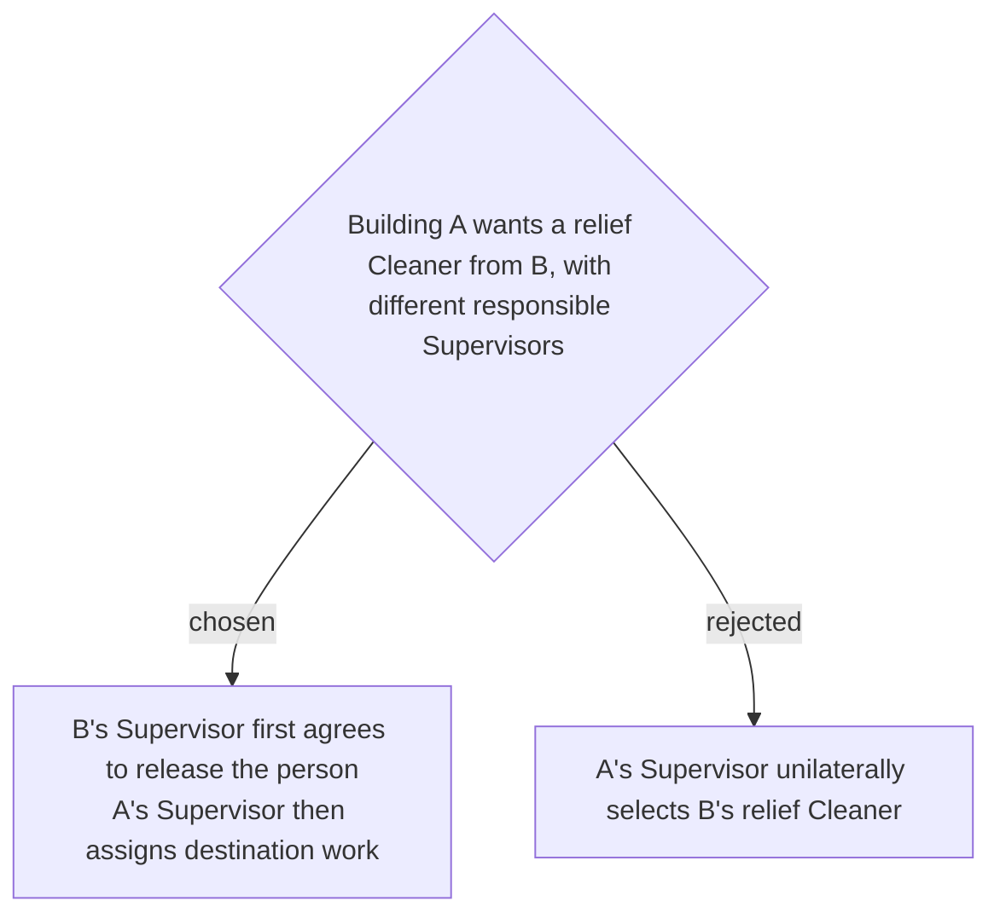

# The source-building Supervisor agrees before another Supervisor assigns borrowed relief staff

On 2026-11-17 the owner selected “ให้ซุป B ตกลงก่อน (แนะนำ)”. For the home-building and surplus-borrowing model in [0194](facility-0194-relief-cleaners-have-home-buildings-with-surplus-borrowing.md), when source and destination buildings have different responsible Supervisors, the source-building Supervisor must agree that the person can be released before the destination Supervisor assigns destination work. This resolves the previously deferred agreement-authority question; do not re-ask it.

This does not decide whether the agreement is made outside the web app or through an in-app approval action, what exact record proves agreement, or cancellation/recall after work starts. Do not grant unrestricted cross-building editing or borrowing before agreement. The destination Supervisor still manages only their assigned buildings and shift; the relief Cleaner retains their regular shift. If the same Supervisor manages both buildings, this decision does not invent two different actors or a second approval.

Record authorisation separately from actual arrival under [0204](facility-0204-midshift-transfer-requires-one-destination-sign-arrival-confirmation.md). An agreed loan is not proof of attendance. Existing assignments must not be silently deleted or moved merely by selecting the person. Accepted design only; no application/schema/database/runtime changes, implementation or publication approval.

**Recording mechanism resolved:** [0207](facility-0207-destination-supervisor-records-relief-loan-after-offline-agreement.md) confirms agreement through the existing channel followed by destination Supervisor recording, without a new in-app approval workflow. Other conflict/recall details remain subject to explicit scoped actions.
