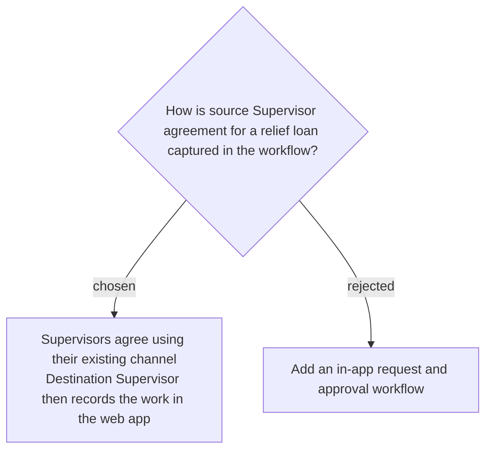

# The destination Supervisor records a relief loan after agreement outside the web app

On 2026-11-17 the owner selected “ตกลงกันก่อนแล้วบันทึก (แนะนำ)”. Under [0206](facility-0206-source-building-supervisor-agrees-before-cross-team-relief-assignment.md), the source-building Supervisor first agrees that the person can be released. Supervisors use their existing communication channel; the destination Supervisor then records destination work in the web app. Do not invent the actual communication medium or require the source Supervisor to click an approval button in this product.

The record must remain distinguishable from a source Supervisor's authenticated in-app approval: the destination actor records an agreement made outside the app, not a signature impersonating the source actor. Exact fields and conflict-validation details belong in the spec. Normal assigned-building/shift restrictions and audit requirements still apply. This mechanism does not grant broad source-building schedule editing or authority to erase an existing assignment. Do not automatically move a currently assigned relief Cleaner, assume someone is available based solely on their home building, or create attendance from an agreed loan.

If one Supervisor is responsible for both buildings, do not introduce an artificial second actor or approval. Midshift changes, when applicable, follow [0203](facility-0203-midshift-area-transfer-preserves-shift-and-break-progress.md)/[0204](facility-0204-midshift-transfer-requires-one-destination-sign-arrival-confirmation.md). This resolves the web-versus-outside-web mechanism left open by 0206. Accepted design only; no implementation, schema/database/runtime changes or publication approval.
