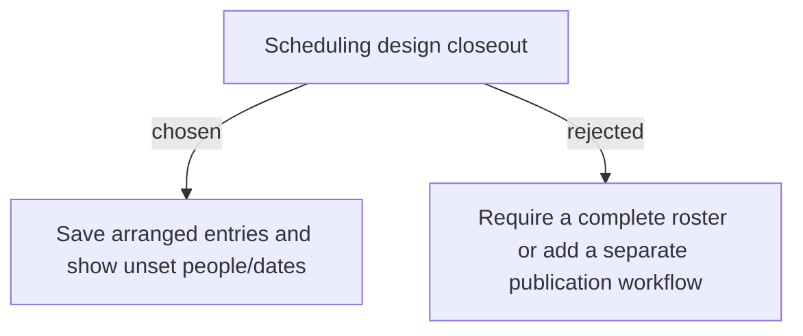

# Save incomplete rosters with visible gaps

On 2026-11-17 the owner confirmed the consolidated recap and requested the scheduling spec (“ยืนยันชุดนี้ เขียน spec ต่อ”). This records the corresponding accepted choice in [the closeout review](../requirements-gathering/2026-11-17-scheduling-design-closeout.md).

A saved roster may still be incomplete. Show missing choices and the relief six-workday check separately from save success. Never infer a workday or day off from an unset field. No new draft/publication state is introduced.

Accepted design only. This does not approve application implementation, schema/database/runtime changes, deployment or publication. The scheduling spec will define the contracts and acceptance cases before an implementation plan is approved.
