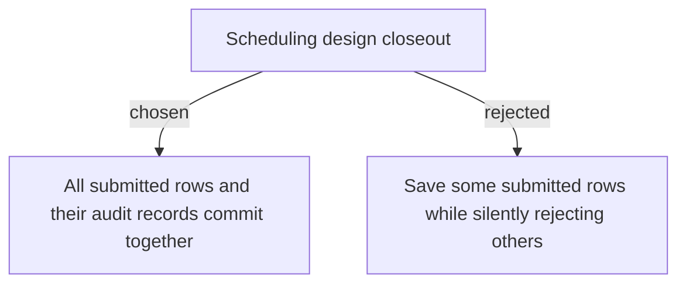

# Save the submitted scheduling batch atomically

On 2026-11-17 the owner confirmed the consolidated recap and requested the scheduling spec (“ยืนยันชุดนี้ เขียน spec ต่อ”). This records the corresponding accepted choice in [the closeout review](../requirements-gathering/2026-11-17-scheduling-design-closeout.md).

The batch may contain only the people already arranged under 0208. Validate every submitted row, revision and authority in one transaction; any failure leaves all submitted rows unchanged. This does not require every person in the week to be submitted.

Accepted design only. This does not approve application implementation, schema/database/runtime changes, deployment or publication. The scheduling spec will define the contracts and acceptance cases before an implementation plan is approved.
