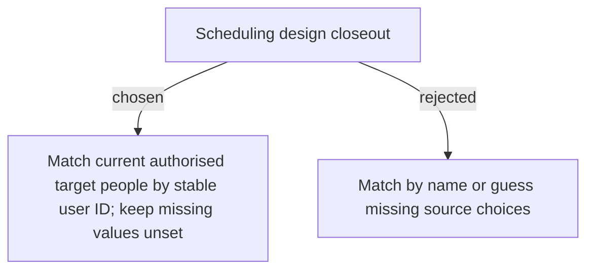

# Copy day-off choices by stable identity and preserve source gaps

On 2026-11-17 the owner confirmed the consolidated recap and requested the scheduling spec (“ยืนยันชุดนี้ เขียน spec ต่อ”). This records the corresponding accepted choice in [the closeout review](../requirements-gathering/2026-11-17-scheduling-design-closeout.md).

This completes 0193: copy only unset target choices, preserve saved/local values, never import departed source members into the target list, and report people without source choices. Review/save remain separate.

Accepted design only. This does not approve application implementation, schema/database/runtime changes, deployment or publication. The scheduling spec will define the contracts and acceptance cases before an implementation plan is approved.
