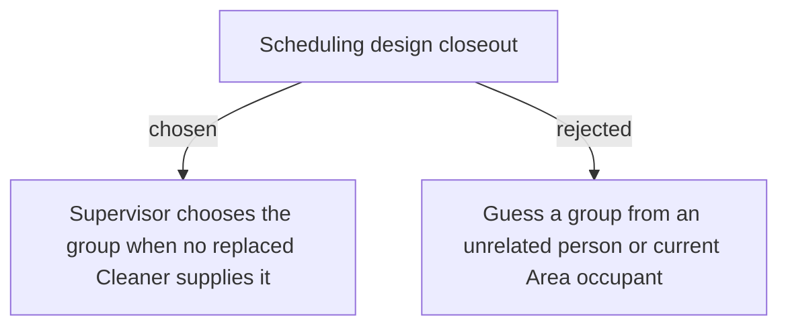

# Choose a first-break group explicitly for relief work without a replaced Cleaner

On 2026-11-17 the owner confirmed the consolidated recap and requested the scheduling spec (“ยืนยันชุดนี้ เขียน spec ต่อ”). This records the corresponding accepted choice in [the closeout review](../requirements-gathering/2026-11-17-scheduling-design-closeout.md).

When replacing a named regular Cleaner, retain 0152 inheritance plus explicit dated overrides. For standalone work with nobody being replaced, require an explicit group for that working assignment. Do not globally require this field on unrelated legacy callers.

Accepted design only. This does not approve application implementation, schema/database/runtime changes, deployment or publication. The scheduling spec will define the contracts and acceptance cases before an implementation plan is approved.
