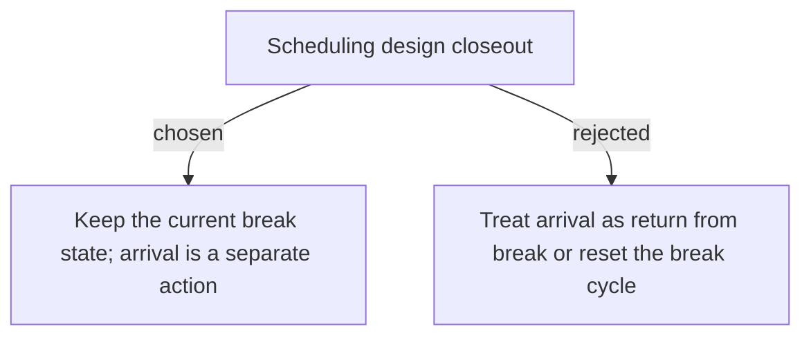

# Preserve an in-progress break across an Area transfer

On 2026-11-17 the owner confirmed the consolidated recap and requested the scheduling spec (“ยืนยันชุดนี้ เขียน spec ต่อ”). This records the corresponding accepted choice in [the closeout review](../requirements-gathering/2026-11-17-scheduling-design-closeout.md).

This clarifies 0203/0204. An arrival confirmation never fabricates BreakIn/BreakOut. A group change cannot create past events or start a second copy of a cycle already underway; retained plan and actual facts stay distinguishable.

Accepted design only. This does not approve application implementation, schema/database/runtime changes, deployment or publication. The scheduling spec will define the contracts and acceptance cases before an implementation plan is approved.
