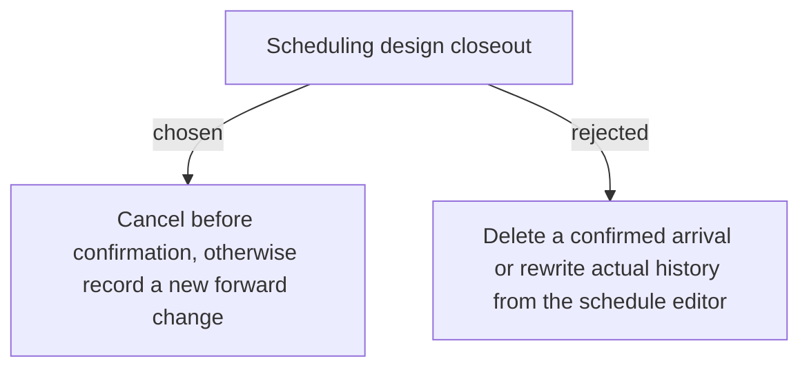

# Cancel pending transfers; append changes after confirmed arrival

On 2026-11-17 the owner confirmed the consolidated recap and requested the scheduling spec (“ยืนยันชุดนี้ เขียน spec ต่อ”). This records the corresponding accepted choice in [the closeout review](../requirements-gathering/2026-11-17-scheduling-design-closeout.md).

Use version checks against arrival/cancellation races. Cancelling a pending instruction retains its history; if already confirmed, keep that evidence and use another authorised change for subsequent work. Correct genuinely incorrect actual evidence only through authorised correction paths.

Accepted design only. This does not approve application implementation, schema/database/runtime changes, deployment or publication. The scheduling spec will define the contracts and acceptance cases before an implementation plan is approved.
