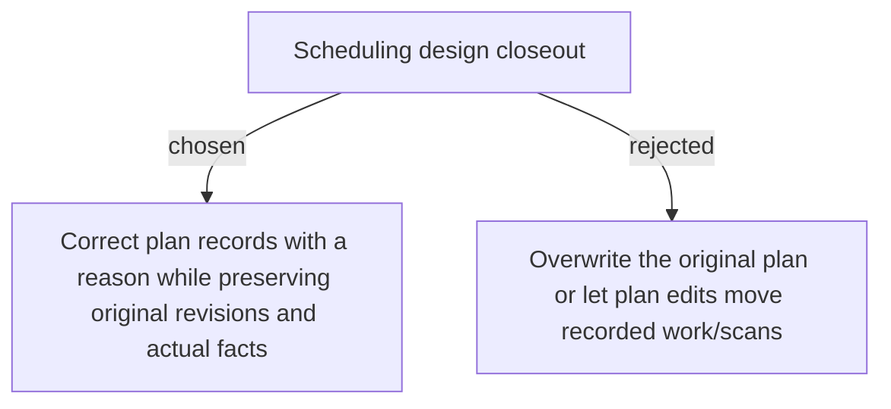

# Historical plan corrections require reason and history

On 2026-11-17 the owner confirmed the consolidated recap and requested the scheduling spec (“ยืนยันชุดนี้ เขียน spec ต่อ”). This records the corresponding accepted choice in [the closeout review](../requirements-gathering/2026-11-17-scheduling-design-closeout.md).

Within scoped authority, distinguish a deliberate correction from a new future baseline. Retain before/after and actor; do not rewrite attendance, Scan Records, inspection results or fabricate retrospective eligibility. Regular-baseline editor future-start rule 0187 remains.

Accepted design only. This does not approve application implementation, schema/database/runtime changes, deployment or publication. The scheduling spec will define the contracts and acceptance cases before an implementation plan is approved.
