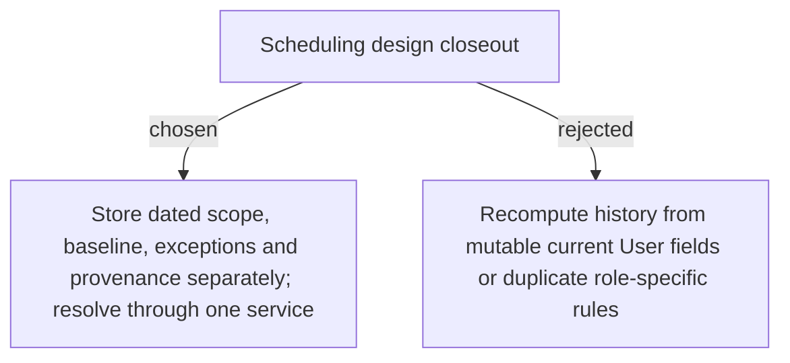

# Use effective-dated scheduling records and a shared scoped projection

On 2026-11-17 the owner confirmed the consolidated recap and requested the scheduling spec (“ยืนยันชุดนี้ เขียน spec ต่อ”). This records the corresponding accepted choice in [the closeout review](../requirements-gathering/2026-11-17-scheduling-design-closeout.md).

Use dated Supervisor building membership, regular/relief baselines, explicit weekly choices and dated exceptions. Reads return effective values with provenance and revision. New authorisation/validation applies to consuming paths; do not add new required fields to unrelated existing endpoints.

Accepted design only. This does not approve application implementation, schema/database/runtime changes, deployment or publication. The scheduling spec will define the contracts and acceptance cases before an implementation plan is approved.
