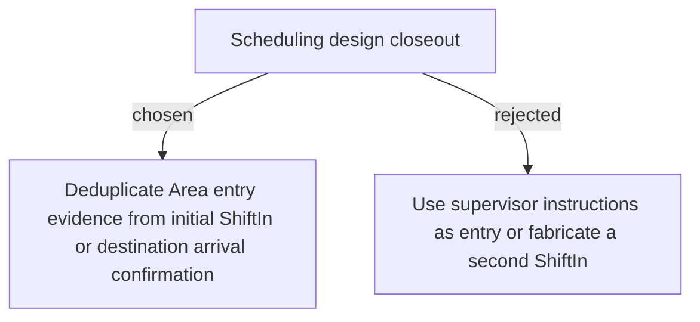

# Overview entry includes confirmed transfer arrival

On 2026-11-17 the owner confirmed the consolidated recap and requested the scheduling spec (“ยืนยันชุดนี้ เขียน spec ต่อ”). This records the corresponding accepted choice in [the closeout review](../requirements-gathering/2026-11-17-scheduling-design-closeout.md).

This closes D7: an Area entered earlier in the slot stays counted, including A after transfer; B counts only after real confirmation. Preserve the three categories and denominator, and keep historical entry separate from current responsibility. Assignment without arrival remains assigned-without-entry.

Accepted design only. This does not approve application implementation, schema/database/runtime changes, deployment or publication. The scheduling spec will define the contracts and acceptance cases before an implementation plan is approved.
