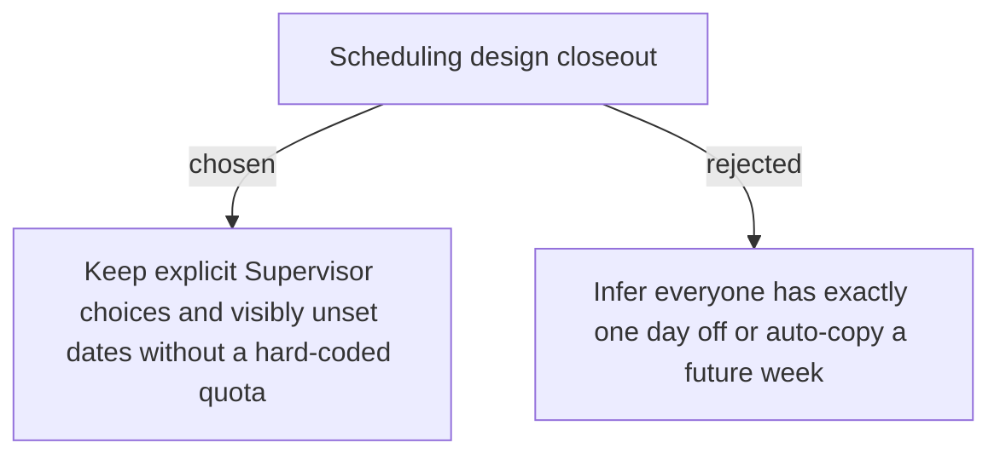

# Do not invent a day-off quota or automatic weekly defaults

On 2026-11-17 the owner confirmed the consolidated recap and requested the scheduling spec (“ยืนยันชุดนี้ เขียน spec ต่อ”). This records the corresponding accepted choice in [the closeout review](../requirements-gathering/2026-11-17-scheduling-design-closeout.md).

This does not revoke the accepted relief six-workday target. Do not turn fixture examples into mandatory regular-Cleaner day-off counts. No compensatory day or other-week edit is generated when work occurs on a day off.

Accepted design only. This does not approve application implementation, schema/database/runtime changes, deployment or publication. The scheduling spec will define the contracts and acceptance cases before an implementation plan is approved.
