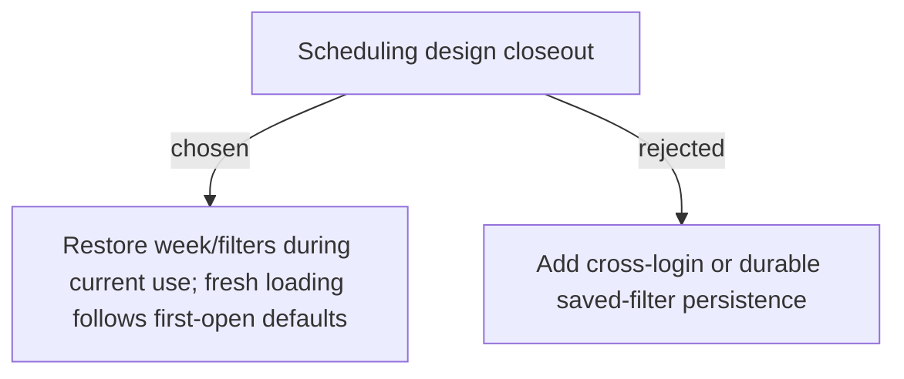

# Limit schedule return memory to ongoing use

On 2026-11-17 the owner confirmed the consolidated recap and requested the scheduling spec (“ยืนยันชุดนี้ เขียน spec ต่อ”). This records the corresponding accepted choice in [the closeout review](../requirements-gathering/2026-11-17-scheduling-design-closeout.md).

This completes 0181/0182/0185 without changing initial overnight rules. Reload, logout/new login and new tab use initial defaults. Returning within ongoing navigation retains the last authorised week/filters; no additional individual-day persistence is promised.

Accepted design only. This does not approve application implementation, schema/database/runtime changes, deployment or publication. The scheduling spec will define the contracts and acceptance cases before an implementation plan is approved.
