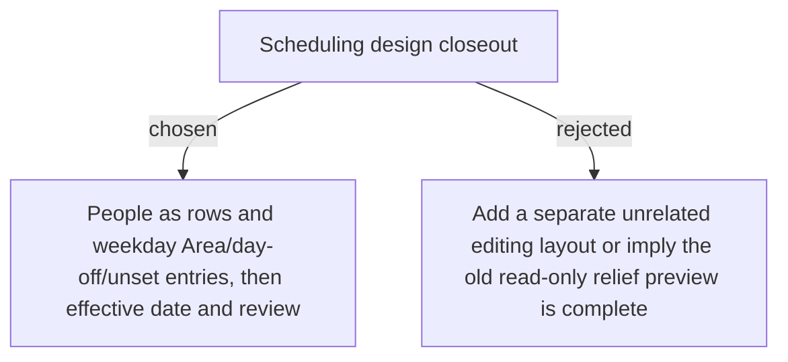

# Use the multi-person weekly roster for relief timetable editing

On 2026-11-17 the owner confirmed the consolidated recap and requested the scheduling spec (“ยืนยันชุดนี้ เขียน spec ต่อ”). This records the corresponding accepted choice in [the closeout review](../requirements-gathering/2026-11-17-scheduling-design-closeout.md).

Reuse the accepted roster language, distinguish home building from destination work, and keep recurring pattern versus selected-date change separate. Reference previous mockup as layout baseline, not evidence that this new editor is already simulated or implemented.

Accepted design only. This does not approve application implementation, schema/database/runtime changes, deployment or publication. The scheduling spec will define the contracts and acceptance cases before an implementation plan is approved.
