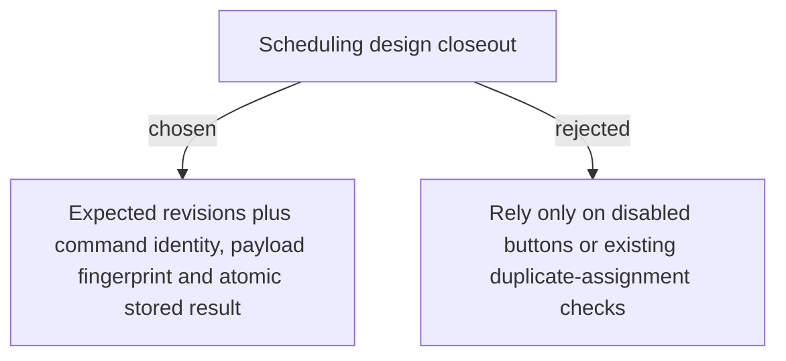

# Use revisions and durable command receipts for scheduling writes

On 2026-11-17 the owner confirmed the consolidated recap and requested the scheduling spec (“ยืนยันชุดนี้ เขียน spec ต่อ”). This records the corresponding accepted choice in [the closeout review](../requirements-gathering/2026-11-17-scheduling-design-closeout.md).

Implements 0165–0167: same command/payload returns the original result, reused identity with different payload is rejected, and uncertain outcome is resolved before another mutation. Scope status reads; receipt expiry must never allow an old committed command to be applied again.

Accepted design only. This does not approve application implementation, schema/database/runtime changes, deployment or publication. The scheduling spec will define the contracts and acceptance cases before an implementation plan is approved.
